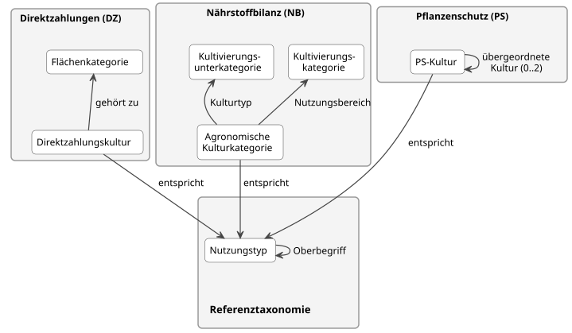
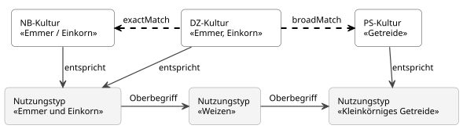
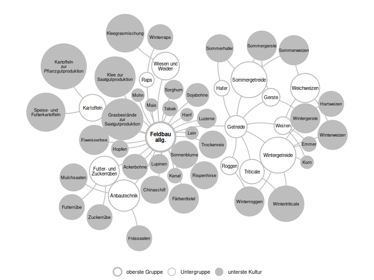
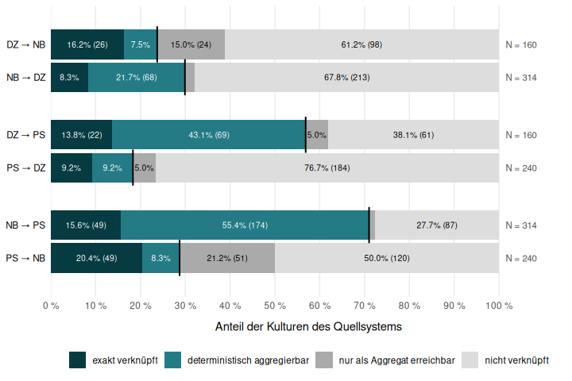
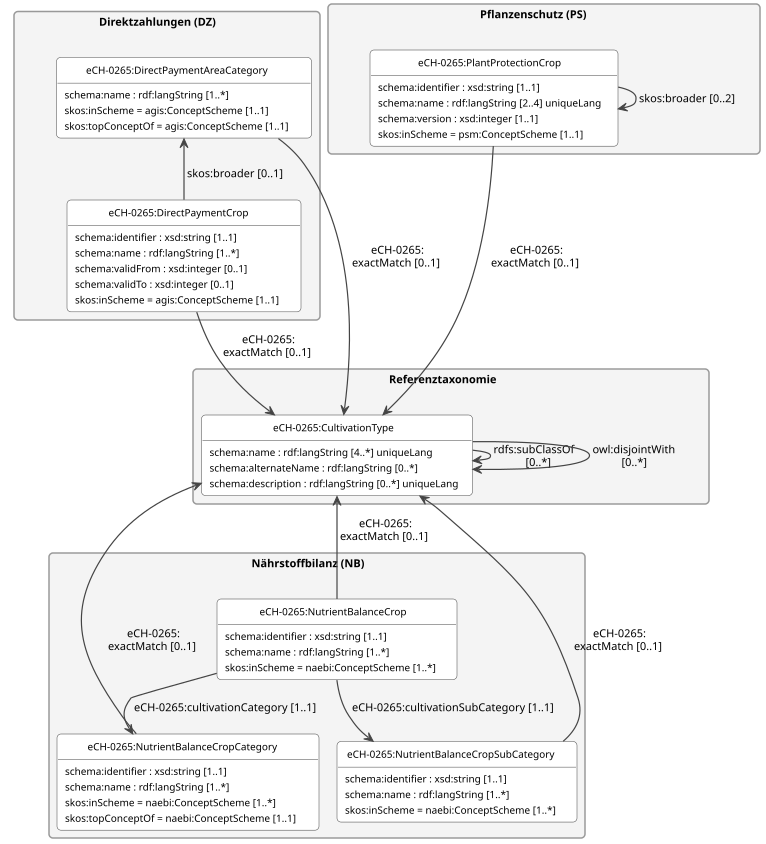

# Landwirtschaftliche Kulturen

2026-10-05

- [Hinweis](#sec-note)
- [<span class="toc-section-number">1</span>
  Einleitung](#sec-introduction)
  - [<span class="toc-section-number">1.1</span> Status](#sec-status)
  - [<span class="toc-section-number">1.2</span>
    Anwendungsgebiet](#sec-scope)
  - [<span class="toc-section-number">1.3</span> Aufbau des
    Dokuments](#sec-structure)
- [<span class="toc-section-number">2</span> Der Begriff der
  landwirtschaftlichen Kultur](#sec-what-is-a-crop)
- [<span class="toc-section-number">3</span> Kulturbegriffe der drei
  Bereiche](#sec-domains)
  - [<span class="toc-section-number">3.1</span>
    Direktzahlungen](#sec-direct-payments)
  - [<span class="toc-section-number">3.2</span>
    Nährstoffbilanz](#sec-nutrient-balance)
  - [<span class="toc-section-number">3.3</span>
    Pflanzenschutz](#sec-plant-protection)
  - [<span class="toc-section-number">3.4</span> Vergleich der drei
    Systeme](#sec-comparison)
- [<span class="toc-section-number">4</span>
  Datenmodell](#sec-data-model)
  - [<span class="toc-section-number">4.1</span>
    Grundprinzipien](#sec-principles)
  - [<span class="toc-section-number">4.2</span> Der Nutzungstyp als
    Referenztaxonomie](#sec-cultivation-type)
  - [<span class="toc-section-number">4.3</span> Bereichsspezifische
    Konzeptschemata](#sec-concept-schemes)
  - [<span class="toc-section-number">4.4</span> Ableitung der
    Beziehungen zwischen den Bereichen](#sec-mapping-derivation)
  - [<span class="toc-section-number">4.5</span>
    Qualitätssicherung](#sec-quality)
- [<span class="toc-section-number">5</span> Interoperabilität der
  Kulturbegriffe](#sec-interoperability)
  - [<span class="toc-section-number">5.1</span> Bekannte
    Einschränkungen](#sec-limitations)
- [<span class="toc-section-number">6</span> Datenbezug und
  Nutzung](#sec-data-retrieval)
  - [<span class="toc-section-number">6.1</span> Bezug der Stammdaten
    über LINDAS](#sec-lindas-data-integration)
  - [<span class="toc-section-number">6.2</span> Bezug der
    Mapping-Tabellen](#sec-mapping-tables)
  - [<span class="toc-section-number">6.3</span> Typische
    Anwendungsfälle](#sec-use-cases)
  - [<span class="toc-section-number">6.4</span> Pflege, Aktualisierung
    und Versionierung](#sec-maintenance)
- [<span class="toc-section-number">7</span> Klassen des
  Datenmodells](#sec-class-reference)
  - [<span class="toc-section-number">7.1</span>
    Namespaces](#sec-namespaces)
  - [<span class="toc-section-number">7.2</span> Agronomische
    Kulturkategorie](#sec-nodeshape-nutrientbalancecrop)
  - [<span class="toc-section-number">7.3</span>
    Direktzahlungskultur](#sec-nodeshape-directpaymentcrop)
  - [<span class="toc-section-number">7.4</span> Flächenkategorie
    Direktzahlung](#sec-nodeshape-directpaymentareacategory)
  - [<span class="toc-section-number">7.5</span>
    Nutzungstyp](#sec-nodeshape-cultivationtype)
  - [<span class="toc-section-number">7.6</span>
    Nährstoffbilanz-Kultivierungskategorie](#sec-nodeshape-nutrientbalancecropcategory)
  - [<span class="toc-section-number">7.7</span>
    Nährstoffbilanz-Kultivierungsunterkategorie](#sec-nodeshape-nutrientbalancecropsubcategory)
  - [<span class="toc-section-number">7.8</span>
    Pflanzenschutz-Kultur](#sec-nodeshape-plantprotectioncrop)
- [<span class="toc-section-number">8</span>
  Sicherheitsüberlegungen](#sec-safety-consideration)
- [<span class="toc-section-number">9</span> Haftungsausschluss und
  Hinweise auf Rechte Dritter](#sec-disclaimer)
- [<span class="toc-section-number">10</span>
  Urheberrechte](#sec-copyrights)
- [Anhang A – Referenzen](#sec-appendix-a)
- [Anhang B – Mitwirkung und Prüfung](#sec-appendix-b)
- [Anhang C – Abkürzungen und Glossar](#sec-appendix-c)
- [Anhang D – Änderungen gegenüber der Vorversion](#sec-appendix-d)
- [Anhang E – Abbildungsverzeichnis](#sec-appendix-e)
- [Anhang F – Tabellenverzeichnis](#sec-appendix-f)

# Hinweis

Im vorliegenden Dokument wird bei der Bezeichnung von Personen eine
geschlechtsneutrale Formulierung verwendet. Basis bildet der Leitfaden
der Bundeskanzlei. Je nach Situation kommen Paarformen (Bürgerinnen und
Bürger), geschlechtsabstrakte Formen (versicherte Person),
geschlechtsneutrale Formen (Versicherte) oder Umschreibungen ohne
Personenbezug zum Einsatz. Das generische Maskulin (Bürger) ist nicht
zulässig. Vollformen werden in fortlaufenden Texten verwendet, also in
Texten, die aus ausformulierten Sätzen bestehen. In verknappten
Textpassagen, namentlich in Tabellen, können Kurzformen verwendet
werden. Dabei wird die Kurzform mit Schrägstrich, aber ohne
Auslassungsstrich verwendet (Referent/in). Genderstern und ähnliche
Schreibweisen werden nicht verwendet.

# Einleitung

Die Definitionen landwirtschaftlicher Kulturen wurden in der Schweiz
historisch unabhängig voneinander für spezifische gesetzliche Aufträge
und Informationssysteme entwickelt. Verschiedene Themenbereiche sprechen
von «Kulturen», meinen damit aber nicht unbedingt dasselbe, da sie ganz
unterschiedliche Blickwinkel haben: Die Direktzahlungen typisieren
Flächen für die Beitragsberechtigung, die Nährstoffbilanz ordnet jeder
Kultur einen normierten Nährstoffbedarf zu, und das
Pflanzenschutzmittelverzeichnis regelt, auf welchen Kulturen ein
Pflanzenschutzmittel angewendet werden darf. Die fehlende
systemübergreifende Harmonisierung (eine *Single Source of Truth*)
erschwert die Informationsverarbeitung über die jeweiligen Systemgrenzen
hinaus.

Das vorliegende Hilfsmittel löst dieses Problem nicht durch eine
Vereinheitlichung der Kulturbegriffe, sondern durch deren Übersetzung:
Die drei Kulturlisten bleiben unverändert bestehen und werden über eine
gemeinsame Referenztaxonomie miteinander verknüpft. Daraus entstehen
Mapping-Tabellen, die zusammen mit den Kulturlisten als maschinenlesbare
*Linked Data* bereitstehen.

## Status

In Arbeit: Der Gebrauch ist nur innerhalb der Fachgruppe,
beziehungsweise im Expertenausschuss zugelassen.

Inhalt, Datenmodell und Daten dieses Hilfsmittels können sich bis zum
Abschluss des Standardisierungsprozesses laufend ändern. Die jeweils
gültige Fassung wird auf <https://ech.ch/de/ech/ech-0265/> publiziert;
der aktuelle Arbeitsstand ist auf GitHub einsehbar:
<https://github.com/blw-ofag-ufag/eCH-0265>.

Als Hilfsmittel formuliert dieses Dokument keine Vorgaben. Es
unterstützt die Datenintegration über Bereiche und Organisationen
hinweg, indem es fertige Kulturentabellen und die dazugehörigen
Mapping-Tabellen bereitstellt.

## Anwendungsgebiet

Dieses Hilfsmittel richtet sich an Fachpersonen und Entwickelnde, die
Daten zu landwirtschaftlichen Kulturen zwischen den Bereichen
Direktzahlungen (DZ), Nährstoffbilanz (NB) und Pflanzenschutz (PS)
austauschen oder gemeinsam auswerten
(<a href="#tbl-domains" class="quarto-xref">Tabelle 1</a>). Es umfasst:

- die Kulturlisten der drei Bereiche mit ihren Identifikatoren,
  Bezeichnungen und bereichsinternen Strukturen,
- eine bereichsübergreifende Referenztaxonomie der Nutzungstypen,
- die daraus abgeleiteten Mapping-Tabellen zwischen den Bereichen sowie

Sämtliche Referenzdaten sind dabei als *Linked Data* maschinenlesbar
verfügbar.

Nicht Gegenstand sind Flächen und Geometrien[^1], Sorten sowie
Direktzahlungsprogramme.[^2] Die fachlichen und rechtlichen Grundlagen
der einzelnen Bereiche bleiben massgeblich; das Hilfsmittel bildet sie
ab, ersetzt sie aber nicht. Die drei Bereiche sind nach ihrer Aufgabe
benannt, nicht nach Organisationseinheiten; die zuständigen
Bundesstellen nennt
<a href="#tbl-domains" class="quarto-xref">Tabelle 1</a>.

<div id="tbl-domains">

Tabelle 1: Die drei Bereiche mit den in diesem Dokument verwendeten
Abkürzungen, dem Quellsystem ihrer Kulturliste, der zuständigen
Bundesstelle und der Anzahl aktuell geltender Kulturen (Stand Juli
2026).

| Bereich | Quellsystem der Kulturliste | Zuständig | Kulturen |
|:---|:---|:---|---:|
| Direktzahlungen (DZ) | Agrarpolitisches Informationssystem (AGIS) | BLW | 159 |
| Nährstoffbilanz (NB) | Nährstoffbilanz-Berechnungsservice (NBBS) | BLW | 314 |
| Pflanzenschutz (PS) | Pflanzenschutzmittelverzeichnis (PSM-V) | BLW/BLV | 321 |

</div>

## Aufbau des Dokuments

<a href="#sec-what-is-a-crop" class="quarto-xref">Kapitel 2</a> klärt,
was in diesem Hilfsmittel unter einer landwirtschaftlichen Kultur
verstanden wird.
<a href="#sec-domains" class="quarto-xref">Kapitel 3</a> beschreibt die
Kulturbegriffe der drei Bereiche und zeigt, worin sie sich
unterscheiden.
<a href="#sec-data-model" class="quarto-xref">Kapitel 4</a> erläutert
das Datenmodell auf konzeptioneller Ebene: die Referenztaxonomie, die
bereichsspezifischen Konzeptschemata und die Ableitung der Beziehungen
zwischen den Bereichen.
<a href="#sec-interoperability" class="quarto-xref">Kapitel 5</a> misst,
wie weit sich die Kulturen damit ineinander überführen lassen, und
benennt die Grenzen.
<a href="#sec-data-retrieval" class="quarto-xref">Kapitel 6</a> zeigt
schliesslich, wie die Daten bezogen, genutzt und gepflegt werden.
<a href="#sec-class-reference" class="quarto-xref">Kapitel 7</a>
dokumentiert die technische Umsetzung mit allen Klassen und Attributen.

# Der Begriff der landwirtschaftlichen Kultur

Der Begriff der landwirtschaftlichen Kultur stützt sich in diesem
Hilfsmittel massgeblich auf das Konzept `CultivationType` aus der
Vorversion \[eCH-0265 1.0.0\]. Eine Kultur definiert sich demnach als
Kategorie beziehungsweise als Teil eines Kategorisierungssystems,
welches die Art der Nutzung und Kultivierung eines bestimmten Stücks
Land über einen definierten Zeitraum beschreibt.

Durch diese Definition ist die landwirtschaftliche Kultur strikt von der
botanischen Taxonomie abzugrenzen. Die botanische Systematik
klassifiziert einzelne Pflanzen. Die landwirtschaftliche Kultur hingegen
typisiert keine Individuen, sondern spezifische Formen der Landnutzung.
Es geht bei der Kultur folglich nicht um die biologische Pflanze an
sich, sondern um die flächen- und zeitbezogene Bewirtschaftungsform, an
welche die jeweiligen agronomischen, rechtlichen oder systemischen
Eigenschaften geknüpft sind.[^3]

Diese Definition gilt für alle drei Bereiche gleichermassen, auch wenn
jeder Bereich seine Kulturen nach eigenen Kriterien abgrenzt. Im
Datenmodell dieses Hilfsmittels wird der bereichsübergreifende
Kulturbegriff als *Nutzungstyp* bezeichnet
(<a href="#sec-cultivation-type" class="quarto-xref">Kapitel 4.2</a>).
Die Kulturen der Bereiche bleiben daneben als eigenständige Begriffe
erhalten; sie werden im Folgenden als Direktzahlungskulturen,
Nährstoffbilanz-Kulturen beziehungsweise PS-Kulturen bezeichnet.

# Kulturbegriffe der drei Bereiche

In den folgenden Abschnitten werden die Kategorisierungssysteme
landwirtschaftlicher Kulturen der drei Bereiche beschrieben: ihr Zweck,
ihre Grundlagen, ihr Quellsystem und ihre Struktur.
<a href="#sec-comparison" class="quarto-xref">Kapitel 3.4</a> stellt die
drei Systeme einander gegenüber und zeigt, weshalb sie sich nicht
einfach vereinheitlichen lassen.

## Direktzahlungen

Direktzahlungen sind Beiträge des Bundes an Landwirtschaftsbetriebe, die
unter anderem den ökologischen Leistungsnachweis (ÖLN) erfüllen. Die
Beitragsberechtigung hängt von der Nutzung der einzelnen Flächen ab,
weshalb jede Fläche eines Betriebs einer Direktzahlungskultur zugeordnet
wird. Im Rahmen des Direktzahlungssystems sind 159
Direktzahlungskulturen (Stand Juli 2026) definiert, welche im Rahmen der
Strukturdatenerhebung von den Bewirtschaftenden in den kantonalen
Agrarinformationssystemen (KAIS) eingetragen und an das agrarpolitische
Informationssystem (AGIS) des Bundes übermittelt werden.

Betriebe, die Direktzahlungen beziehen, deklarieren dabei ihre gesamte
landwirtschaftliche Nutzfläche gegenüber dem Kanton, nicht nur die
beitragsberechtigten Flächen. Die Kantone übermitteln diese Daten
jährlich an AGIS, wo sie als Grundlage für die Berechnung der
Direktzahlungen dienen (vgl. [Flächenkatalog und
Beitragsberechtigung](https://www.blw.admin.ch/dam/fr/sd-web/QYLa6wGfdK8G/2026%20Merkblatt%20Nr.%206.2%20Fl%C3%A4chenkatalog%20und%20Beitragsberechtigung.pdf)).
Betriebe ohne Direktzahlungsbezug sind hingegen nicht zur Deklaration
verpflichtet und daher in AGIS nicht oder nur unvollständig erfasst. In
AGIS stehen somit alle aktuell gültigen und historisierten
Direktzahlungskulturen und deren Beitragsberechtigungen für Bund und
Kantone zur Verfügung. Momentan können diese Daten aber nicht in
maschinenlesbarer Form vom AGIS-Webservice bezogen werden.

Die Direktzahlungskulturen kommen nicht nur im Rahmen der
Strukturdatenerhebung zum Einsatz, sondern auch bei der
gesamtschweizerischen räumlichen Erfassung von Nutzungsflächen (siehe
[«landwirtschaftliche
Kulturflächen»](https://www.blw.admin.ch/de/landwirtschaftliche-kulturflaechen)).
Die Kantone erfassen diese Geodaten gemäss dem minimalen Geodatenmodell
153.1 «Nutzungsflächen» und stellen die Daten via dem interkantonalen
Portal [geodienste.ch](https://geodienste.ch/) zur Verfügung. Die im
Rahmen der Geodaten verwendeten Kulturkategorien sind als XML-File auf
<https://models.geo.admin.ch/BLW/> publiziert, wobei weitere
(aggregierende) Kulturkategorien definiert wurden und die
Gültigkeitsangaben nicht deckungsgleich zu denjenigen der
Direktzahlungskulturen der Strukturdatenerhebung (AGIS) sind.

Die Direktzahlungskulturen sind selbst in acht Flächenkategorien
eingeteilt (<a href="#tbl-directpaymentcrops-categories"
class="quarto-xref">Tabelle 2</a>). Eine Mehrheit dieser Kategorien wird
explizit in der landwirtschaftlichen Begriffsverordnung (LBV) definiert.

<div id="tbl-directpaymentcrops-categories">

Tabelle 2: Anzahl Direktzahlungskulturen (N) je Kulturkategorie
(Kategorie) mit Referenzen auf die geltende Definition in der
landwirtschaftlichen Begriffsverordnung (LBV), wo möglich.

| N | Kategorie | Definition | Beispiele |
|:---|:---|:---|:---|
| 72 | Ackerfläche | [Art. 18 LBV](https://www.fedlex.admin.ch/eli/cc/1999/13/de#art_18) | «Futterweizen gemäss Sortenliste swiss granum», «Winterraps zur Speiseölgewinnung», «Winterraps als nachwachsender Rohstoff» |
| 15 | Dauergrünfläche | [Art. 19 LBV](https://www.fedlex.admin.ch/eli/cc/1999/13/de#art_19) | «Extensiv genutzte Wiesen (ohne Weiden)», «Übrige Grünfläche (Dauergrünfläche), beitragsberechtigt» |
| 27 | Dauerkulturen | [Art. 22 LBV](https://www.fedlex.admin.ch/eli/cc/1999/13/de#art_22) | «Reben», «Obstanlagen (Äpfel)», «Reben (regionsspezifische Biodiversitätsförderfläche)» |
| 14 | Kulturen in ganzjährig geschütztem Anbau | [Art. 14 Abs. 1 Bst. e LBV](https://www.fedlex.admin.ch/eli/cc/1999/13/de#art_14) | «Gemüsekulturen in Gewächshäusern mit festem Fundament», «Übrige Spezialkulturen in geschütztem Anbau ohne festes Fundament» |
| 6 | Weitere Flächen innerhalb der landwirtschaftlichen Nutzfläche |  | «Streueflächen innerhalb der landwirtschaftlichen Nutzfläche», «Hecken-, Feld- und Ufergehölze (mit Pufferstreifen) (regionsspezifische Biodiversitätsförderfläche)» |
| 11 | Flächen ausserhalb der landwirtschaftlichen Nutzfläche |  | «Wald», «Trockenmauern», «Hausgärten» |
| 5 | Flächen im Sömmerungsgebiet | [Art. 24 LBV](https://www.fedlex.admin.ch/eli/cc/1999/13/de#art_24) | «Sömmerungsweiden», «Artenreiche Grün- und Streueflächen im Sömmerungsgebiet» |
| 9 | Andere Elemente |  | «Hochstammfeldobstbäume», «Nussbäume», «Einheimische standortgerechte Einzelbäume und Alleen» |

</div>

## Nährstoffbilanz

Die «Grundlagen für die Düngung landwirtschaftlicher Kulturen in der
Schweiz» (GRUD) liefern die fachlichen Empfehlungen zum Nährstoffbedarf
der Kulturen, etwa für Stickstoff und Phosphor \[CFGH17\]. Sie legen
fest, wie viel Dünger eine Kultur unter Schweizer Bedingungen benötigt.
Die Suisse-Bilanz ist das Vollzugs- und Kontrollinstrument im
ökologischen Leistungsnachweis (ÖLN): Sie prüft auf Betriebsebene, ob
zugeführte und abgeführte Nährstoffe insgesamt ausgeglichen sind, und
stützt sich dabei auf die Datengrundlagen der GRUD \[AgBL25\]. Kurz
gesagt bestimmen die GRUD den Soll-Bedarf, und die Suisse-Bilanz
kontrolliert, ob ein Betrieb seine Nährstoffe im Rahmen dieses Bedarfs
bewirtschaftet. Weil jede Kultur einen anderen normierten
Nährstoffbedarf aufweist, ist die Zuweisung der Kulturen die
Grundvoraussetzung jeder Nährstoffbilanz.

Massgeblich für die Berechnung ist die «Wegleitung Suisse-Bilanz»,
herausgegeben von Agridea und dem Bundesamt für Landwirtschaft (BLW)
\[AgBL25\]. Sie enthält zahlreiche nach Kulturen gegliederte
Referenztabellen, abgeleitet von den detaillierteren Tabellen der GRUD.

Zur Standardisierung der Suisse-Bilanz-Berechnung stellt das BLW neu den
Nährstoffbilanz-Berechnungsservice (NBBS) als Programmierschnittstelle
(API) zur Verfügung. Über diese Schnittstelle lässt sich unter anderem
ein Katalog der landwirtschaftlichen Kulturen abrufen.[^4] Die
eigentlichen Kulturen heissen im NBBS «agronomische Kulturkategorien».
Jede von ihnen ist genau einer Kultivierungskategorie und genau einer
Kultivierungsunterkategorie zugeordnet
(<a href="#tbl-nbbs-classes" class="quarto-xref">Tabelle 3</a>).

<div id="tbl-nbbs-classes">

Tabelle 3: Klassen der Kulturen im Nährstoffbilanz-Berechnungsservice
und Anzahl der Elemente (N) je Klasse, Stand Juli 2026.

| N | Name | Beschreibung | Beispiele |
|:---|:---|:---|:---|
| 3 | Kultivierungskategorien (`cultivationcategories`) | Gruppierung der Kulturen nach Nutzungsbereich, dient nur der Strukturierung. | Ackerkulturen, Grundfutterproduktion, Spezialkulturen |
| 8 | Kultivierungsunterkategorien (`cultivationsubcategories`) | Gruppierung der Kulturen nach Kulturtyp, dient ebenfalls nur der Strukturierung. | Getreide, Dauerkulturen, Hackfrüchte, Freilandgemüse, geschützte Kulturen, Grundfutter, übriger Ökoausgleich, diverse Kulturen |
| 314 | Agronomische Kulturkategorien (`agronomiccropcategories`) | Die eigentlichen Kulturen, jeweils einer Kategorie und einer Unterkategorie zugeordnet. Hier sind die spezifischen agronomischen und regulatorischen Eigenschaften hinterlegt. | «Winterweizen», «Zuckerrüben», «Naturwiese extensiv», «Aubergine, Erdkultur (geschützter Anbau)», «Walnüsse ≥ 185 Bäume/ha» |

</div>

Entgegen dem ersten Anschein bilden diese drei Klassen keine dreistufige
Hierarchie. Die Unterkategorien sind den Kategorien nicht untergeordnet;
vielmehr handelt es sich um zwei unabhängige Gruppierungen, die sich
beide direkt auf die Kulturen beziehen. Die Kultivierungskategorie
gruppiert nach Nutzungsbereich, die Kultivierungsunterkategorie nach
Kulturtyp, und derselbe Kulturtyp kann in mehreren Nutzungsbereichen
vorkommen
(<a href="#tbl-nbbs-crosstab" class="quarto-xref">Tabelle 4</a>). So
sind «Silomais» und «Futterrüben» Hackfrüchte der Grundfutterproduktion,
«Zuckerrüben» hingegen Hackfrüchte der Ackerkulturen; «Getreide-Silage»
ist Getreide der Grundfutterproduktion, «Winterweizen» Getreide der
Ackerkulturen.

<div id="tbl-nbbs-crosstab">

Tabelle 4: Anzahl agronomischer Kulturkategorien im
Nährstoffbilanz-Berechnungsservice je Kultivierungsunterkategorie
(Zeilen) und Kultivierungskategorie (Spalten). Die Unterkategorien
«Diverse Kulturen», «Getreide», «Hackfrüchte» und «übriger Ökoausgleich»
kommen in mehr als einer Kategorie vor.

<div class="cell-output-display">

| Unterkategorie | Ackerkulturen | Grundfutterproduktion | Spezialkulturen |
|:---|---:|---:|---:|
| Altre colture | 18 |  | 8 |
| Altre sup. per la compensazione ecologica | 3 |  | 3 |
| Autre compensation écologique | 3 |  | 3 |
| Cereali | 22 | 2 |  |
| Colture perenni | 1 |  | 76 |
| Colture protette |  |  | 29 |
| Cultures divers | 18 |  | 8 |
| Cultures pérennes | 1 |  | 76 |
| Cultures sarclées | 19 | 3 |  |
| Cultures sous abri |  |  | 29 |
| Céréales | 22 | 2 |  |
| Dauerkulturen | 1 |  | 76 |
| Diverse Kulturen | 18 |  | 8 |
| Foraggio di base |  | 25 |  |
| Fourrage de base |  | 25 |  |
| Freilandgemüse |  |  | 105 |
| Geschützte Kulturen |  |  | 29 |
| Getreide | 22 | 2 |  |
| Grundfutter |  | 25 |  |
| Hackfrüchte | 19 | 3 |  |
| Légumes de pleine terre |  |  | 105 |
| Ortaggi di pieno campo |  |  | 105 |
| Sarchiate | 19 | 3 |  |
| übriger Ökoausgleich | 3 |  | 3 |

</div>

</div>

Während Kategorien und Unterkategorien rein der Strukturierung und
Gruppierung dienen, weisen die agronomischen Kulturkategorien
spezifische agronomische und regulatorische Eigenschaften auf. Dazu
gehören beispielsweise der Ertrag, die Zulässigkeit für bestimmte
Direktzahlungsprogramme oder die Teilnahme an spezifischen Vorhaben wie
dem «62a Nitrat-Projekt».

## Pflanzenschutz

Das [Pflanzenschutzmittelverzeichnis (PSM-V)](https://www.psm.admin.ch/)
ist das offizielle Register des Bundes, das alle in der Schweiz
zugelassenen Pflanzenschutzmittel auflistet. Es regelt, für welche
Kulturen und unter welchen Bedingungen diese rechtmässig eingesetzt
werden dürfen. Es wird vom Bundesamt für Lebensmittelsicherheit und
Veterinärwesen (BLV) gepflegt und umfasst 321 definierte Kulturen (Stand
Juli 2026). Die Bezeichnungen dieser Kulturen liegen mehrsprachig auf
Deutsch, Französisch und Italienisch sowie teilweise auf Englisch vor.

Anders als die Kulturlisten der Direktzahlungen und der Nährstoffbilanz,
die ihre Kulturen in wenige flache Gruppen einteilen, sind die Kulturen
im PSM-V als Objekte in einer flexiblen Polyhierarchie modelliert. Dies
bedeutet, dass ein Element mehr als ein Überelement aufweisen kann,
welches wiederum eigenen Überelementen untergeordnet ist.

Diese Struktur wurde ursprünglich von der [*European and Mediterranean
Plant Protection Organization* (EPPO)](https://eppo.int/) abgeleitet,
anschliessend aber für die spezifischen Schweizer Anforderungen weiter
modifiziert. Die Organisation in Übergruppen erlaubt eine äusserst
flexible Modellierung: Gewisse Äste der Hierarchie sind flach, während
andere sehr tief verschachtelt sein können. Eine Kultur kann dabei bis
zu zwei direkte Übergruppen besitzen. So ist beispielsweise die
*Sommergerste* sowohl der Übergruppe «Gerste» als auch dem
«Sommergetreide» untergeordnet.

Die Hierarchietiefe kann bis zu fünf Übergruppen umfassen, wie folgendes
Beispiel aus dem Gemüsebau verdeutlicht:

1.  **Schnittsalat**, gehört zu
2.  **Blattsalate (Asteraceae)**, gehört zu
3.  **Lactuca-Salate**, gehört zu
4.  **Salate (Asteraceae)**, gehört zu
5.  **Korbblütler (Asteraceae)**, gehört zu
6.  **Gemüsebau allg.**

Die präzise Abbildung dieser Hierarchie ist fachlich von grosser
Bedeutung, da die Zulassungslogik direkt in die Struktur des PSM-V
eingebaut ist. Wenn eine Pflanzenschutzmittel-Anwendung für eine
übergeordnete Kulturgruppe bewilligt ist, gilt diese Bewilligung
automatisch auch für sämtliche untergeordneten Kulturen.

Ein Beispiel hierfür: Das Herbizid [«Ariane
C»](https://www.psm.admin.ch/de/produkte/7430) darf gegen «ein- und
mehrjährige Dicotyledonen» in «Getreiden» eingesetzt werden. Damit darf
es auf alle Kulturen angewendet werden, welche vom PSM-V als Getreide
klassifiziert sind. Die korrekte Nachbildung dieser Polyhierarchie ist
in den Daten folglich essenziell, um Zulassungen maschinell korrekt zu
verarbeiten.

## Vergleich der drei Systeme

Die drei Kategorisierungssysteme verfolgen unterschiedliche Zwecke und
sind entsprechend unterschiedlich aufgebaut
(<a href="#tbl-comparison" class="quarto-xref">Tabelle 5</a>). Sie
unterscheiden sich nicht nur darin, *wie* sie ihre Kulturen gliedern,
sondern auch darin, *was* sie überhaupt klassieren: Die Direktzahlungen
typisieren jede Fläche eines Betriebs, einschliesslich Einzelelementen
wie Bäumen oder Hecken. Die Nährstoffbilanz enthält neben Kulturen auch
reine Bilanzpositionen wie «Zwischenfutter». Das
Pflanzenschutzmittelverzeichnis beschreibt Anwendungsbereiche von
Pflanzenschutzmitteln, von der einzelnen Kultur bis zu sehr allgemeinen
Gruppen wie «Offene Ackerfläche».

<div id="tbl-comparison">

Tabelle 5: Gegenüberstellung der Kategorisierungssysteme der drei
Bereiche.

|  | Direktzahlungen (DZ) | Nährstoffbilanz (NB) | Pflanzenschutz (PS) |
|:---|:---|:---|:---|
| Zweck | Beitragsberechtigung von Flächen | Normierter Nährstoffbedarf je Kultur | Zulassung von Pflanzenschutzmitteln je Kultur |
| Klassiert werden | Landnutzungen einer Fläche inklusive Einzelelemente | Kulturen und Bilanzpositionen eines Betriebs | Kulturen und Kulturgruppen als Anwendungsbereiche |
| Struktur | Eine Ebene mit acht Flächenkategorien | Zwei unabhängige Gruppierungen mit drei Kategorien und acht Unterkategorien | Polyhierarchie mit bis zu sechs Ebenen und bis zu zwei Übergruppen je Kultur |
| Identifikator | Numerischer Direktzahlungscode | Alphanumerischer Code (z.B. `CROP_ABRGS`) | Technischer Schlüssel (UUID) |
| Sprachen | Deutsch, Französisch, Italienisch | Deutsch | Deutsch, Französisch, Italienisch, teilweise Englisch |
| Maschinenlesbare Quelle | Nein | Ja (API des NBBS) | Ja (PSM-V) |

</div>

Die Unterschiede betreffen nicht nur die Struktur, sondern auch den
Inhalt scheinbar identischer Begriffe. So zählt der NBBS Mais,
Buchweizen und Quinoa zum Getreide, das PSM-V hingegen explizit
nicht.[^5] Wer eine Kulturliste von einem Bereich in einen anderen
überträgt, muss solche Divergenzen kennen und eindeutig benennen können.
Wegen ihrer unterschiedlichen Zwecke lassen sich die drei Systeme nicht
zu einem einzigen vereinheitlichen. Das folgende Kapitel zeigt, wie
eCH-0265 sie dennoch miteinander verknüpft.

# Datenmodell

Dieses Kapitel beschreibt das Datenmodell auf konzeptioneller Ebene: die
beteiligten Begriffe, ihre Beziehungen zueinander und die Prinzipien,
nach denen sie verknüpft werden. Die technische Umsetzung mit ihren
Klassen, Attributen und Kardinalitäten ist in
<a href="#sec-class-reference" class="quarto-xref">Kapitel 7</a>
dokumentiert.

## Grundprinzipien

Das Datenmodell beruht auf vier Prinzipien:

1.  **Eindeutige Identifikation.** Jede Kultur, jede Gruppe und jeder
    Nutzungstyp ist eine eigenständige Ressource mit einem weltweit
    eindeutigen, dauerhaften Identifikator (IRI), über den sie im Web
    aufgelöst werden kann. Das «Getreide» des PSM-V und das «Getreide»
    des NBBS sind damit zwei verschiedene, klar unterscheidbare
    Ressourcen.
2.  **Eigenständige Bereiche.** Jede Kulturliste wird als eigenes
    Konzeptschema abgebildet und behält Identifikatoren, Bezeichnungen
    und interne Struktur ihres Quellsystems unverändert bei.
3.  **Eine gemeinsame Referenz.** Alle Kulturen der drei Bereiche
    verweisen auf eine gemeinsame Referenztaxonomie der Nutzungstypen.
    Sie ist das einzige Element, das die Bereiche direkt miteinander
    verbindet
    (<a href="#fig-conceptual-model" class="quarto-xref">Abbildung 1</a>).
    Die Elemente der Referenztaxonomie bekommen ausserdem eine
    eindeutige Bezeichnung.
4.  **Abgeleitete statt gepflegte Beziehungen.** Die Beziehungen
    zwischen den Kulturen zweier Bereiche werden nicht manuell gepflegt,
    sondern aus der Referenztaxonomie abgeleitet. Ändert sich die
    Taxonomie, ändern sich die Mapping-Tabellen automatisch mit.

<div id="fig-conceptual-model">



Abbildung 1: Konzeptionelles Datenmodell von eCH-0265. Die Kulturlisten
der drei Bereiche bleiben eigenständige Objekte mit ihrer jeweiligen
internen Struktur. Jede Kultur verweist auf den Nutzungstyp der
gemeinsamen Referenztaxonomie, dem sie entspricht; nur über diese
Verweise sind die Bereiche miteinander verbunden.

</div>

Die Daten werden als Linked Data nach den Grundsätzen von \[eCH-0205
1.0.0\] publiziert. Die Konzeptschemata folgen dem *Simple Knowledge
Organization System* \[SKOS\], die Referenztaxonomie der *Web Ontology
Language* (OWL) \[OWL Overview\]. Der modulare Aufbau erlaubt es, die
historisch gewachsenen, in sich geschlossenen Kategoriensysteme unter
Beibehaltung ihrer fachlichen und rechtlichen Eigenschaften in einem
gemeinsamen Graphen abzubilden und trotzdem miteinander zu verknüpfen.

## Der Nutzungstyp als Referenztaxonomie

Ein Nutzungstyp ist eine bereichsübergreifend definierte Form der
Landnutzung im Sinne von
<a href="#sec-what-is-a-crop" class="quarto-xref">Kapitel 2</a>,
beispielsweise «Sommergerste», «Dauergrünfläche» oder
«Gewächshausgurken». Die Referenztaxonomie umfasst rund 750
Nutzungstypen (Stand Juli 2026), die viersprachig benannt sind und wo
nötig eine Beschreibung sowie Synonyme tragen. Sie geht auf das Konzept
`CultivationType` der Vorversion zurück \[eCH-0265 1.0.0\] und wurde so
erweitert, dass jede Kultur der drei Bereiche einen entsprechenden
Nutzungstyp findet.

Die Nutzungstypen sind über Oberbegriffe hierarchisch geordnet:
«Sommergerste» ist ein Unterbegriff von «Gerste» und von
«Sommergetreide», diese sind Unterbegriffe von «Getreide», und über
mehrere Stufen führt die Hierarchie bis zur «Ackerfläche» und zur
«Landwirtschaftlichen Nutzfläche». Ein Nutzungstyp kann mehrere
Oberbegriffe haben, und die Hierarchie ist je nach Ast unterschiedlich
tief. An der Spitze stehen vier Wurzeln: die landwirtschaftliche
Nutzfläche (LN), die Flächen ausserhalb der LN, die Sömmerungsfläche und
die Einzelelemente wie Bäume und Hecken. Zusammengesetzte Nutzungstypen
wie «Gewächshausgurken» sind als Schnittmenge ihrer Bestandteile
definiert, hier von «Gurken» und «Geschützter Anbau», und erben damit
die Einordnung beider.

Die Referenztaxonomie ist bewusst kein weiteres fachliches
Kategorisierungssystem; sie trägt keine agronomischen oder rechtlichen
Eigenschaften. Ihre einzige Aufgabe ist es, festzuhalten, welche
Nutzungsformen fachübergreifend dasselbe bedeuten und wie sie sich
zueinander verhalten. Fehlt für eine Kultur eines Bereichs ein passender
Nutzungstyp, wird die Taxonomie ergänzt.

## Bereichsspezifische Konzeptschemata

Jeder Bereich bildet ein eigenes Konzeptschema. Es enthält die Kulturen
mit dem Identifikator und den Bezeichnungen des Quellsystems sowie die
bereichsinterne Struktur
(<a href="#fig-conceptual-model" class="quarto-xref">Abbildung 1</a>):

- **Direktzahlungen.** Jede Direktzahlungskultur gehört zu genau einer
  Flächenkategorie (<a href="#tbl-directpaymentcrops-categories"
  class="quarto-xref">Tabelle 2</a>) und trägt ihren zeitlichen
  Gültigkeitsbereich, da Kulturen eingeführt und wieder aufgehoben
  werden. Aufgehobene Kulturen bleiben im Schema erhalten, damit
  historische Daten interpretierbar bleiben.
- **Nährstoffbilanz.** Jede Nährstoffbilanz-Kultur ist genau einer
  Kultivierungskategorie und genau einer Kultivierungsunterkategorie
  zugeordnet; die beiden Gruppierungen stehen in keiner Beziehung
  zueinander
  (<a href="#sec-nutrient-balance" class="quarto-xref">Kapitel 3.2</a>).
- **Pflanzenschutz.** Jede PS-Kultur kann bis zu zwei übergeordnete
  Kulturen haben. Damit wird die Polyhierarchie des Verzeichnisses
  vollständig nachgebildet, einschliesslich der Vererbung von
  Zulassungen an untergeordnete Kulturen.

Jede Kultur und jede Gruppe eines Konzeptschemas verweist auf höchstens
einen Nutzungstyp der Referenztaxonomie, dem sie inhaltlich entspricht.
Dieser Verweis ist die einzige Information, die bei der Aufnahme einer
Kultur manuell gepflegt wird. Einzelne Kulturen ohne entsprechenden
Nutzungstyp, etwa reine Bilanzpositionen der Nährstoffbilanz wie «Vom
Betrieb weggeführtes Stroh», bleiben ohne Verweis und damit ohne
Beziehung zu den anderen Bereichen.

## Ableitung der Beziehungen zwischen den Bereichen

Aus den Verweisen auf die Referenztaxonomie werden die Beziehungen
zwischen den Kulturen verschiedener Bereiche abgeleitet
(<a href="#fig-mapping-derivation" class="quarto-xref">Abbildung 2</a>).
Verwendet werden die drei Mapping-Beziehungen von SKOS \[SKOS\]:

- `skos:exactMatch`: Zwei Kulturen verweisen auf denselben Nutzungstyp;
  sie bedeuten dasselbe.
- `skos:broadMatch`: Der Nutzungstyp der Kultur im Quellsystem ist ein
  Unterbegriff des Nutzungstyps der Kultur im Zielsystem; die Kultur im
  Zielsystem ist allgemeiner.
- `skos:narrowMatch`: Die Umkehrung von `skos:broadMatch`; die Kultur im
  Zielsystem ist spezifischer.

<div id="fig-mapping-derivation">



Abbildung 2: Ableitung der Beziehungen an einem Beispiel. Durchgezogene
Pfeile sind fachlich gepflegte Beziehungen: die Verweise der Kulturen
auf ihren Nutzungstyp und die Oberbegriffe der Referenztaxonomie.
Gestrichelte Pfeile sind daraus automatisch abgeleitet. Die
Direktzahlungskultur «Emmer, Einkorn» und die Nährstoffbilanz-Kultur
«Emmer / Einkorn» verweisen auf denselben Nutzungstyp und sind deshalb
exakt verknüpft. Die PS-Kultur «Getreide» verweist auf einen Oberbegriff
dieses Nutzungstyps, weshalb die Direktzahlungskultur zu ihr in einer
allgemeineren Beziehung steht.

</div>

Die Beziehungen werden je Zielsystem nach einer festen Rangfolge
abgeleitet.[^6] Allgemeinere Beziehungen (`skos:broadMatch`) entstehen
nur, wenn im Zielsystem keine exakte Entsprechung existiert, und
spezifischere Beziehungen (`skos:narrowMatch`) nur, wenn weder eine
exakte noch eine allgemeinere Beziehung besteht. «Sommergerste» (DZ) ist
deshalb ausschliesslich exakt mit «Sommergerste» (PS) verknüpft, obwohl
ihr Nutzungstyp auch ein Unterbegriff von «Gerste» und «Getreide» ist.
Diese Rangfolge hält die Mapping-Tabellen frei von redundanten
Beziehungen: Für jede Kultur und jedes Zielsystem gibt es nur eine Art
von Beziehung, und zwar die genaueste verfügbare.

<div id="tbl-mapping-example">

Tabelle 6: Beispiele der abgeleiteten Beziehungen zwischen den Bereichen
Direktzahlungen (DZ), Nährstoffbilanz (NB) und Pflanzenschutz (PS).

| Quelle | SKOS-Beziehung | Ziel | Begründung |
|:---|:---|:---|:---|
| Sommergerste (DZ) | `skos:exactMatch` | Sommergerste (NB) | Beide Kulturen verweisen auf den Nutzungstyp «Sommergerste». |
| Emmer, Einkorn (DZ) | `skos:broadMatch` | Getreide (PS) | Der Nutzungstyp «Emmer und Einkorn» ist ein Unterbegriff von «Kleinkörniges Getreide», auf das die PS-Kultur verweist. |
| Kernobst (PS) | `skos:narrowMatch` | Obstanlagen (Äpfel) (DZ) | Umkehrung: Der Nutzungstyp der Direktzahlungskultur ist ein Unterbegriff von «Kernobst», die Kultur im Zielsystem ist also spezifischer. |

</div>

## Qualitätssicherung

Die Daten werden bei jeder Änderung automatisiert aufbereitet: Die
Konzeptschemata und die Referenztaxonomie werden zusammengeführt,
implizite Oberbegriffe werden durch logisches Schliessen ergänzt, die
Beziehungen zwischen den Bereichen werden abgeleitet, und der
resultierende Graph wird gegen formale Regeln geprüft. Solche Regeln
legen beispielsweise fest, dass jede Kultur genau einen Identifikator
trägt oder dass jede Nährstoffbilanz-Kultur genau einer Kategorie und
einer Unterkategorie zugeordnet ist. Nur ein Graph, der alle Regeln
erfüllt, wird publiziert. Die Regeln sind in
<a href="#sec-class-reference" class="quarto-xref">Kapitel 7</a>
dokumentiert.

# Interoperabilität der Kulturbegriffe

Semantische Interoperabilität bedeutet, dass die Bedeutung (die
*Semantik*) einer Information beim Austausch zwischen Systemen erhalten
bleibt \[EC17\]. Die abgeleiteten Beziehungen aus
<a href="#sec-mapping-derivation" class="quarto-xref">Kapitel 4.4</a>
bilden dafür ein sogenanntes *Alignment* zwischen den drei unabhängig
entstandenen Kategorisierungssystemen der Direktzahlungen (DZ), der
Nährstoffbilanz (NB) und des Pflanzenschutzes (PS); die verwendeten
SKOS-Beziehungen entsprechen den Äquivalenz- und Hierarchie-Mappings
nach \[ISO 25964-2; SKOS\]. Dieses Kapitel quantifiziert, wie weit die
beschriebenen Kulturen ohne manuellen Eingriff in ein anderes System
überführt werden können, und benennt anschliessend die bekannten Grenzen
dieser Übersetzung.

<div id="fig-psm-hierarchy">



Abbildung 3: Ausschnitt aus der Hierarchie der Kulturen im
Pflanzenschutzmittelverzeichnis: die oberste Gruppe «Feldbau allg.» mit
allen Untergruppen und Kulturen des Ackerbaus. Gezeigt ist damit nur ein
kleiner Teil der Taxonomie; das Verzeichnis umfasst über 300 Kulturen in
mehr als 20 obersten Gruppen. Grau gefüllte Knoten sind unterste
Kulturen; nur sie gehen in die Kennzahlen dieses Kapitels ein. Umrandete
Knoten sind übergeordnete Gruppen, die weder bei der Abbildbarkeit noch
bei der Abdeckung mitzählen. Kulturen mit zwei Übergruppen, etwa
«Winterroggen» unter «Roggen» und «Wintergetreide», sind mit beiden
verbunden.

</div>

Berücksichtigt werden nur aktuell geltende Kulturen ohne
Strukturierungsebenen: die Flächenkategorien der Direktzahlungen sowie
die Kategorien und Unterkategorien der Nährstoffbilanz bleiben aussen
vor, und im PSM-V zählen nur die untersten Kulturen, nicht übergeordnete
Gruppen wie «Getreide» oder «Wintergetreide»
(<a href="#fig-psm-hierarchy" class="quarto-xref">Abbildung 3</a>).[^7]

Die Kultur eines Quellsystems gilt als *deterministisch abbildbar* in
ein Zielsystem, wenn mindestens ein `skos:exactMatch` oder mindestens
ein `skos:broadMatch` zu einer Kultur des Zielsystems vorliegt. Diese
Überführung mittels `skos:exactMatch` ist verlustfrei; ein
`skos:broadMatch` ordnet die Kultur einer allgemeineren Kategorie zu,
etwa «Winterraps zur Speiseölgewinnung» (Direktzahlungen) hin zu
«Winterraps» (Pflanzenschutzmittelverzeichnis): Detailinformation geht
dabei verloren, das Ziel ist aber ohne Zusatzwissen eindeutig.

Liegt hingegen ein `skos:narrowMatch` vor, ist das Ziel spezifischer als
die Quelle, und die Auswahl unter den Kandidaten erfordert Information,
die in den Quelldaten fehlt. So kann «Hafer» (Direktzahlungen) nur mit
Kenntnis des Saatzeitpunkets auf «Sommerhafer»
(Pflanzenschutzmittelverzeichnis) abgebildet werden, ein altbekanntes
Problem beim Mapping zwischen Vokabularen unterschiedlicher Granularität
\[Doer01; ZeCh04\].

Aus Sicht des Zielsystems ist eine solche Kultur nur als Aggregat
erreichbar. Die *deterministische Abbildbarkeit* ist der Anteil der
deterministisch abbildbaren Kulturen an allen Kulturen des Quellsystems;
sie ist gerichtet, weil eine Aggregation nur in eine Richtung eindeutig
ist. <a href="#fig-mappability" class="quarto-xref">Abbildung 4</a>
stellt deshalb jeweils beide Systeme eines Paars gegenüber.

<div id="fig-mappability">



Abbildung 4: Beziehung der Kulturen eines Quellsystems zu den Kulturen
eines Zielsystems für die drei Paare zwischen den Bereichen
Direktzahlungen (DZ), Nährstoffbilanz (NB) und Pflanzenschutz (PS).
Jeder Balken zeigt die N geltenden Kulturen des Quellsystems und ihre
Beziehung zum Zielsystem: exakt verknüpft (`skos:exactMatch`),
deterministisch aggregierbar (`skos:broadMatch`), nur als Aggregat
erreichbar (`skos:broadMatch`) oder nicht verknüpft. Zahlen sind Anteile
in Prozent mit der Anzahl Kulturen in Klammern; die schwarze Markierung
ist die deterministische Abbildbarkeit.

</div>

Am höchsten ist die deterministische Abbildbarkeit für NB/DZ hin zum
PSM-V. Sie beruht überwiegend auf Aggregationen in sehr allgemeine
PS-Kulturen wie «Offene Ackerfläche» oder «Grünfläche» und ist damit nur
ein grober Indikator für die Interoperabilität mit dem
Pflanzenschutzmittelverzeichnis. In der Gegenrichtung ist eine solche
PS-Kultur nur als Aggregat erreichbar (dunkelgrau) und lässt sich nicht
eindeutig auf eine NB- oder DZ-Kultur auflösen. Hellgrau markierte
Kulturen bleiben in beiden Richtungen unerreicht, etwa Heil- und
Gewürzpflanzen wie «Süssdolde» oder «Wolliger Fingerhut» im PSM-V oder
Bilanzpositionen wie «Zwischenfutter» in der NB; die *Abdeckung* in
<a href="#tbl-interoperability" class="quarto-xref">Tabelle 7</a>
beziffert den Anteil der Zielkulturen, die von einem Quellsystem aus
erreicht werden.

<div id="tbl-interoperability">

Tabelle 7: Interoperabilitätskennzahlen zwischen Direktzahlungen (DZ),
Nährstoffbilanz (NB) und Pflanzenschutz (PS): Anzahl geltender Kulturen
im Quellsystem (N), Anteil exakt verknüpfter Kulturen (Exakt),
deterministische Abbildbarkeit (Abbildbar) und Abdeckung des Zielsystems
(Abdeckung).

<div class="cell-output-display">

| Quellsystem | Zielsystem |   N | Exakt | Abbildbar | Abdeckung |
|:------------|:-----------|----:|------:|----------:|----------:|
| NB          | PS         | 314 | 15.6% |     71.0% |     42.1% |
| DZ          | PS         | 159 | 13.2% |     57.2% |     13.8% |
| PS          | NB         | 240 | 20.4% |     31.2% |     18.2% |
| NB          | DZ         | 314 |  8.3% |     28.0% |     30.8% |
| DZ          | NB         | 159 | 16.4% |     24.5% |     10.8% |
| PS          | DZ         | 240 |  8.8% |     17.9% |     20.8% |

</div>

</div>

Die Abbildbarkeit in DZ ist in beiden Richtungen gering, weil DZ auch
Landnutzungen wie Biodiversitätsförderflächen, Sömmerungsflächen oder
Einzelelemente typisiert, die in den anderen Systemen kein Gegenstück
haben. Ackerfläche und Dauergrünfläche lassen sich praktisch vollständig
ins Pflanzenschutzmittelverzeichnis überführen, Sömmerungsflächen
hingegen kaum.

Die in diesem Kapitel präsentierten Kennzahlen werden dabei automatisch
berechnet (Stand der Berechnung: 2026-10-05). Sie beschreiben den
aktuellen Stand der Mapping-Tabellen; fehlende Beziehungen können
fachlich begründet sein oder auf Lücken hinweisen, die bei der Pflege
des Alignments zu priorisieren sind \[EuMoSc08\].

## Bekannte Einschränkungen

Die Kennzahlen zeigen, dass die Übersetzung zwischen den Bereichen nur
teilweise verlustfrei möglich ist. Die wichtigsten Gründe und ihre
Folgen für die Nutzung sind:

- **Unterschiedliche Zwecke.** Die drei Systeme klassieren nicht
  dasselbe
  (<a href="#sec-comparison" class="quarto-xref">Kapitel 3.4</a>).
  Direktzahlungen typisieren Landnutzungen einschliesslich
  Einzelelementen, die Nährstoffbilanz enthält Bilanzpositionen wie
  «Zwischenfutter» oder «Getreide-Silage», und das PSM-V enthält sehr
  allgemeine Anwendungsbereiche. Nicht jede Kultur hat deshalb in jedem
  anderen Bereich ein Gegenstück.
- **Unterschiedliche Granularität.** Wo ein System feiner unterscheidet
  als ein anderes, etwa die Nährstoffbilanz mit Kulturen «in 62a
  Nitrat-Projekt» oder mit Ertragsstufen bei Erdbeeren, existiert nur
  eine allgemeinere Beziehung. Die Übersetzung in das feinere System ist
  dann nicht deterministisch und erfordert eine fachliche Entscheidung.
- **Gruppierungen sind nicht vergleichbar.** Flächenkategorien,
  Kultivierungskategorien und Übergruppen des PSM-V folgen je eigenen
  Logiken. Beziehungen sind nur auf der Ebene der Kulturen belastbar;
  die Gruppierungen der Nährstoffbilanz bilden zudem keine Hierarchie
  (<a href="#sec-nutrient-balance" class="quarto-xref">Kapitel 3.2</a>).
- **Gleiche Namen, verschiedene Bedeutungen.** Begriffe wie «Getreide»
  sind in den Bereichen unterschiedlich abgegrenzt. Bezeichnungen
  reichen für eine Übersetzung nie aus; massgebend sind ausschliesslich
  die Identifikatoren und die abgeleiteten Beziehungen.
- **Manuelle Pflege der Referenz.** Die Verweise der Kulturen auf die
  Nutzungstypen werden manuell gepflegt. Fehlende oder fehlerhafte
  Verweise sind möglich und wirken sich direkt auf die Mapping-Tabellen
  aus. Festgestellte Lücken können gemeldet werden
  (<a href="#sec-maintenance" class="quarto-xref">Kapitel 6.4</a>).
- **Keine Verbindlichkeit.** Die abgeleiteten Beziehungen sind ein
  Hilfsmittel für die Datenintegration und keine fachlichen oder
  rechtlichen Entscheide
  (<a href="#sec-safety-consideration" class="quarto-xref">Kapitel 8</a>).

# Datenbezug und Nutzung

Alle in diesem Dokument beschriebenen Daten – die Referenztaxonomie, die
drei Konzeptschemata und die abgeleiteten Beziehungen – sind als Linked
Data öffentlich verfügbar. Technologische Basis ist das *Resource
Description Framework* (RDF) des World Wide Web Consortium (W3C), in dem
Informationen nicht als Tabellen, sondern als Graph aus Tripeln
(Subjekt, Prädikat, Objekt) abgelegt werden \[RDF\]. Publiziert werden
die Daten auf [LINDAS](https://lindas.admin.ch/), dem Linked Data
Service der Schweizer Bundesverwaltung. LINDAS speichert die Daten in
einem sogenannten *Triple Store* und stellt sie öffentlich über eine
genormte Abfrageschnittstelle bereit. Eine Einführung in die Publikation
und Nutzung von Linked Data gibt \[eCH-0205 1.0.0\].

## Bezug der Stammdaten über LINDAS

Die Kulturenstammdaten können mittels der Abfragesprache SPARQL
\[HaSe13\] direkt aus dem LINDAS-Triplestore bezogen werden. Das
nachfolgende Beispiel zeigt eine einfache Abfrage, welche sämtliche
Nutzungstypen mit deren deutschem Namen zurückgibt:

``` rq
# Table of all cultivation types and their German name
PREFIX eCH-0265: <https://agriculture.ld.admin.ch/eCH-0265/2/>
PREFIX schema: <http://schema.org/>

SELECT *
FROM <https://lindas.admin.ch/foag/ech/0265/2>
WHERE {
  ?crop a eCH-0265:CultivationType ;
    schema:name ?name .
  FILTER(LANG(?name) = "de")
}
ORDER BY ?name
```

Auf <https://lindas.admin.ch/sparql/> können solche Abfragen manuell
über eine grafische Benutzeroberfläche ausgeführt werden. Weitere
praxisnahe Abfragebeispiele stehen im [GitHub Repository unter
src/sparql/queries](https://github.com/blw-ofag-ufag/eCH-0265/tree/main/src/sparql/queries)
zur Verfügung.

Für den automatisierten Datenabruf und die Systemintegration kann der
LINDAS-Endpunkt über einen HTTP-POST-Request angesprochen werden. Dabei
wird die SPARQL-Abfrage direkt im Body der Anfrage übermittelt. Ein
entsprechendes Aufrufbeispiel mit `curl` sieht folgendermassen aus:

``` sh
curl -X POST "https://lindas.admin.ch/query" \
     -H "Content-Type: application/sparql-query" \
     -H "Accept: application/sparql-results+json" \
     --data-binary @query.rq -o data.json
```

Dieser Aufruf setzt voraus, dass eine gültige SPARQL-Abfrage in der
lokalen Datei `query.rq` vorliegt. Je nach Anforderung lässt sich das
Rückgabeformat über den `Accept`-Header steuern. Für `SELECT`-Abfragen
unterstützt LINDAS standardmässig strukturierte Formate wie JSON
(`application/sparql-results+json`), XML
(`application/sparql-results+xml`) und CSV (`text/csv`).

## Bezug der Mapping-Tabellen

Die abgeleiteten Beziehungen
(<a href="#sec-mapping-derivation" class="quarto-xref">Kapitel 4.4</a>)
sind direkt an die Kulturen im Graphen angehängt und auf LINDAS
abfragbar. Eine vorbereitete SPARQL-Abfrage zur Generierung der
vollständigen Mapping-Tabelle zwischen allen drei Bereichen befindet
sich [im eCH-0265 Repository unter
`src/sparql/queries/mapping_table.rq`](https://github.com/blw-ofag-ufag/eCH-0265/blob/main/src/sparql/queries/mapping_table.rq).
Sie liefert je Zeile eine Quellkultur, die Beziehung und die Zielkultur,
jeweils mit Identifikator, Bezeichnung und Konzeptschema. Die Abfrage
kann direkt in der Benutzeroberfläche von LINDAS ausgeführt und als CSV
oder JSON exportiert werden; alternativ lässt sich die Tabelle
programmatisch beziehen (<a href="#sec-lindas-data-integration"
class="quarto-xref">Kapitel 6.1</a>).

## Typische Anwendungsfälle

- **Übersetzung einer Kulturliste.** Die Direktzahlungskulturen eines
  Betriebs aus der Strukturdatenerhebung sollen für die Suisse-Bilanz in
  Nährstoffbilanz-Kulturen überführt werden. Wo eine exakte Entsprechung
  besteht, erfolgt die Übersetzung automatisch; wo nur allgemeinere
  Beziehungen bestehen, liefert die Mapping-Tabelle die Kandidaten für
  eine fachliche Entscheidung.
- **Prüfung von Zulassungen.** Für eine Direktzahlungs- oder
  Nährstoffbilanz-Kultur sollen die zulässigen Pflanzenschutzmittel
  ermittelt werden. Über die exakte und die allgemeineren Beziehungen zu
  PS-Kulturen und deren übergeordnete Kulturen lassen sich alle
  relevanten Anwendungsbereiche im PSM-V bestimmen.
- **Bereichsübergreifende Auswertung.** Flächen oder Kulturen aus
  verschiedenen Systemen sollen gemeinsam ausgewertet werden, etwa alle
  Getreideflächen. Über die Oberbegriffe der Referenztaxonomie lassen
  sich Kulturen aller Bereiche aggregieren, wobei explizit wird, welche
  Definition von «Getreide» der Auswertung zugrunde liegt.

## Pflege, Aktualisierung und Versionierung

Die Kulturlisten der Bereiche werden von den zuständigen Stellen in der
Regel jährlich nachgeführt. Das Hilfsmittel übernimmt diese Änderungen,
ergänzt neue Kulturen um ihren Verweis auf die Referenztaxonomie und
publiziert den aktualisierten Graphen auf LINDAS. Die Identifikatoren
der Kulturen und Nutzungstypen bleiben dabei dauerhaft stabil;
aufgehobene Kulturen werden nicht gelöscht, sondern mit ihrem
Gültigkeitsende versehen. Die Identifikatoren der Klassen und
Eigenschaften des Datenmodells enthalten die Hauptversion des
Hilfsmittels (`.../eCH-0265/2/...`). Nur eine neue Hauptversion mit
nicht abwärtskompatiblen Änderungen führt zu neuen Identifikatoren;
bestehende Daten bleiben unter der bisherigen Version gültig.

Die Weiterentwicklung erfolgt offen auf GitHub. Fehler, fehlende
Kulturen oder Änderungswünsche können als Issue gemeldet
(<https://github.com/blw-ofag-ufag/eCH-0265/issues>) oder über das
offizielle Formular für Änderungsanträge (*Request for Change*) von eCH
eingereicht werden
(<https://ech.ch/de/ech-standards/standardisierungsprozess/request-change-rfc>).
Jede Änderung durchläuft vor der Publikation die automatisierte
Qualitätssicherung
(<a href="#sec-quality" class="quarto-xref">Kapitel 4.5</a>). Versionen
des Hilfsmittels werden mit dem Status des Dokuments bei eCH abgestimmt.

# Klassen des Datenmodells

Dieses Kapitel dokumentiert die technische Umsetzung des in
<a href="#sec-data-model" class="quarto-xref">Kapitel 4</a>
beschriebenen Datenmodells.
<a href="#fig-uml" class="quarto-xref">Abbildung 5</a> zeigt die Klassen
mit ihren Attributen und Beziehungen in der Notation der *Unified
Modeling Language* (UML). Die anschliessende Referenz ist automatisch
aus den SHACL-Shapes (*Shapes Constraint Language*) generiert, mit denen
der publizierte Graph validiert wird \[SHACL\]. Sie führt für jede
Klasse die zulässigen Eigenschaften mit Pfad, Typ und Kardinalität auf.

<div id="fig-uml">



Abbildung 5: UML-Klassendiagramm des Datenmodells von eCH-0265,
abgeleitet aus den SHACL-Shapes. Attribute sind mit Datentyp und
Kardinalität angegeben; `uniqueLang` bedeutet, dass je Sprache höchstens
ein Wert zulässig ist. Alle Kulturen und Gruppen der drei Bereiche
verweisen über `eCH-0265:exactMatch` auf höchstens einen Nutzungstyp der
Referenztaxonomie. `eCH-0265:exactMatch` ist eine Untereigenschaft
(`rdfs:subPropertyOf`) von `skos:exactMatch` die sich nur auf den
Nutzungstyp bezieht.

</div>

## Namespaces

<a href="#tbl-namespaces" class="quarto-xref">Tabelle 8</a> listet die
Präfixe und Namespaces, die das Datenmodell verwendet. Ein Präfix steht
stellvertretend für eine Namespace-IRI, den gemeinsamen Anfang der IRIs
eines Vokabulars.

<div id="tbl-namespaces">

Tabelle 8: In eCH-0265 – Landwirtschaftliche Kulturen verwendete
Namespaces.

| Präfix    | Namespace                                      |
|:----------|:-----------------------------------------------|
| agis:     | https://agriculture.ld.admin.ch/crops/agis/1/  |
| eCH-0265: | https://agriculture.ld.admin.ch/eCH-0265/2/    |
| naebi:    | https://agriculture.ld.admin.ch/crops/naebi/1/ |
| owl:      | http://www.w3.org/2002/07/owl#                 |
| psm:      | https://agriculture.ld.admin.ch/crops/psm/1/   |
| rdf:      | http://www.w3.org/1999/02/22-rdf-syntax-ns#    |
| rdfs:     | http://www.w3.org/2000/01/rdf-schema#          |
| schema:   | http://schema.org/                             |
| skos:     | http://www.w3.org/2004/02/skos/core#           |
| xsd:      | http://www.w3.org/2001/XMLSchema#              |

</div>

## Agronomische Kulturkategorie

Die eigentlichen Kulturen des Nährstoffbilanz-Berechnungsservice mit
spezifischen agronomischen Eigenschaften für die Suisse-Bilanz. Jede
Kultur ist genau einer Kultivierungskategorie und genau einer
Kultivierungsunterkategorie zugeordnet.

### Übersicht

<div class="ech-facts">

Klasse  
[eCH-0265:NutrientBalanceCrop](https://agriculture.ld.admin.ch/eCH-0265/2/NutrientBalanceCrop)

Geschlossen  
Ja (nur die aufgeführten Eigenschaften zulässig)

Kennzahlen  
314 Instanzen mit je 9 bis 18 Tripeln (im Mittel 13.1)

Datenzugriff  
[SPARQL-Dienst](https://lindas.admin.ch/sparql/#query=PREFIX%20eCH-0265%3A%20%3Chttps%3A%2F%2Fagriculture.ld.admin.ch%2FeCH-0265%2F2%2F%3E%0APREFIX%20schema%3A%20%3Chttp%3A%2F%2Fschema.org%2F%3E%0APREFIX%20skos%3A%20%3Chttp%3A%2F%2Fwww.w3.org%2F2004%2F02%2Fskos%2Fcore%23%3E%0ASELECT%20%3Firi%20%3Fidentifier%20%3FinScheme%20%3Fname%20%3FcultivationSubCategory%20%3FcultivationCategory%20%3FexactMatch%0AFROM%20%3Chttps%3A%2F%2Flindas.admin.ch%2Ffoag%2Fech%2F0265%2F2%3E%0AWHERE%20%7B%0A%20%20%3Firi%20a%20eCH-0265%3ANutrientBalanceCrop%20.%0A%20%20%3Firi%20schema%3Aidentifier%20%3Fidentifier%20.%0A%20%20%3Firi%20skos%3AinScheme%20%3FinScheme%20.%0A%20%20%3Firi%20schema%3Aname%20%3Fname%20.%0A%20%20%3Firi%20eCH-0265%3AcultivationSubCategory%20%3FcultivationSubCategory%20.%0A%20%20%3Firi%20eCH-0265%3AcultivationCategory%20%3FcultivationCategory%20.%0A%20%20OPTIONAL%20%7B%20%3Firi%20eCH-0265%3AexactMatch%20%3FexactMatch%20.%20%7D%0A%7D%0ALIMIT%201000)

</div>

### Eigenschaften

<table style="width:100%;">
<colgroup>
<col style="width: 48%" />
<col style="width: 43%" />
<col style="width: 6%" />
</colgroup>
<thead>
<tr>
<th style="text-align: left;">Beschreibung</th>
<th style="text-align: left;">Details</th>
<th style="text-align: right;">Kardinalität</th>
</tr>
</thead>
<tbody>
<tr>
<td style="text-align: left;"><strong>Identifikator</strong> (<a
href="http://schema.org/identifier">schema:identifier</a>)</td>
<td style="text-align: left;"><ul>
<li>Typ: Zeichenkette (<a
href="http://www.w3.org/2001/XMLSchema#string">xsd:string</a>)</li>
</ul></td>
<td style="text-align: right;">1..1</td>
</tr>
<tr>
<td style="text-align: left;"><strong>Konzeptschema</strong> (<a
href="http://www.w3.org/2004/02/skos/core#inScheme">skos:inScheme</a>)</td>
<td style="text-align: left;"><ul>
<li>Pflichtwert: <a
href="https://agriculture.ld.admin.ch/crops/naebi/1/ConceptScheme">naebi:ConceptScheme</a></li>
</ul></td>
<td style="text-align: right;">1..*</td>
</tr>
<tr>
<td style="text-align: left;"><strong>Name</strong> (<a
href="http://schema.org/name">schema:name</a>)</td>
<td style="text-align: left;"><ul>
<li>Typ: Sprachabhängiger Text (<a
href="http://www.w3.org/1999/02/22-rdf-syntax-ns#langString">rdf:langString</a>)</li>
</ul></td>
<td style="text-align: right;">1..*</td>
</tr>
<tr>
<td style="text-align: left;"><strong>Unterkategorie</strong> (<a
href="https://agriculture.ld.admin.ch/eCH-0265/2/cultivationSubCategory">eCH-0265:cultivationSubCategory</a>)</td>
<td style="text-align: left;"><ul>
<li>Typ: <a
href="#sec-nodeshape-nutrientbalancecropsubcategory">Nährstoffbilanz-Kultivierungsunterkategorie</a></li>
</ul></td>
<td style="text-align: right;">1..1</td>
</tr>
<tr>
<td style="text-align: left;"><strong>Kategorie</strong> (<a
href="https://agriculture.ld.admin.ch/eCH-0265/2/cultivationCategory">eCH-0265:cultivationCategory</a>)</td>
<td style="text-align: left;"><ul>
<li>Typ: <a
href="#sec-nodeshape-nutrientbalancecropcategory">Nährstoffbilanz-Kultivierungskategorie</a></li>
</ul></td>
<td style="text-align: right;">1..1</td>
</tr>
<tr>
<td style="text-align: left;"><strong>Nutzungstyp</strong> (<a
href="https://agriculture.ld.admin.ch/eCH-0265/2/exactMatch">eCH-0265:exactMatch</a>):
Der dieser bereichsspezifischen Kultur entsprechende Nutzungstyp in der
Referenztaxonomie.</td>
<td style="text-align: left;"><ul>
<li>Typ: <a href="#sec-nodeshape-cultivationtype">Nutzungstyp</a></li>
</ul></td>
<td style="text-align: right;">0..1</td>
</tr>
</tbody>
</table>

## Direktzahlungskultur

Beschreibt eine Liste der «Kulturen», die gemäss
Direktzahlungsverordnung (DZV) im Bereich Landwirtschaft relevant sind.
Diese «Kulturen» werden für den Direktzahlungsvollzug verwendet. Sie
entsprechen den Hauptkulturen.

### Übersicht

<div class="ech-facts">

Klasse  
[eCH-0265:DirectPaymentCrop](https://agriculture.ld.admin.ch/eCH-0265/2/DirectPaymentCrop)

Geschlossen  
Ja (nur die aufgeführten Eigenschaften zulässig)

Kennzahlen  
182 Instanzen mit je 10 bis 17 Tripeln (im Mittel 12.2)

Datenzugriff  
[SPARQL-Dienst](https://lindas.admin.ch/sparql/#query=PREFIX%20eCH-0265%3A%20%3Chttps%3A%2F%2Fagriculture.ld.admin.ch%2FeCH-0265%2F2%2F%3E%0APREFIX%20schema%3A%20%3Chttp%3A%2F%2Fschema.org%2F%3E%0APREFIX%20skos%3A%20%3Chttp%3A%2F%2Fwww.w3.org%2F2004%2F02%2Fskos%2Fcore%23%3E%0ASELECT%20%3Firi%20%3Fbroader%20%3FinScheme%20%3Fname%20%3Fidentifier%20%3FvalidFrom%20%3FvalidTo%20%3FexactMatch%0AFROM%20%3Chttps%3A%2F%2Flindas.admin.ch%2Ffoag%2Fech%2F0265%2F2%3E%0AWHERE%20%7B%0A%20%20%3Firi%20a%20eCH-0265%3ADirectPaymentCrop%20.%0A%20%20OPTIONAL%20%7B%20%3Firi%20skos%3Abroader%20%3Fbroader%20.%20%7D%0A%20%20%3Firi%20skos%3AinScheme%20%3FinScheme%20.%0A%20%20%3Firi%20schema%3Aname%20%3Fname%20.%0A%20%20%3Firi%20schema%3Aidentifier%20%3Fidentifier%20.%0A%20%20OPTIONAL%20%7B%20%3Firi%20schema%3AvalidFrom%20%3FvalidFrom%20.%20%7D%0A%20%20OPTIONAL%20%7B%20%3Firi%20schema%3AvalidTo%20%3FvalidTo%20.%20%7D%0A%20%20OPTIONAL%20%7B%20%3Firi%20eCH-0265%3AexactMatch%20%3FexactMatch%20.%20%7D%0A%7D%0ALIMIT%201000)

</div>

### Eigenschaften

<table style="width:99%;">
<colgroup>
<col style="width: 45%" />
<col style="width: 45%" />
<col style="width: 8%" />
</colgroup>
<thead>
<tr>
<th style="text-align: left;">Beschreibung</th>
<th style="text-align: left;">Details</th>
<th style="text-align: right;">Kardinalität</th>
</tr>
</thead>
<tbody>
<tr>
<td style="text-align: left;"><strong>Flächenkategorie</strong> (<a
href="http://www.w3.org/2004/02/skos/core#broader">skos:broader</a>)</td>
<td style="text-align: left;"><ul>
<li>Typ: <a
href="#sec-nodeshape-directpaymentareacategory">Flächenkategorie
Direktzahlung</a></li>
</ul></td>
<td style="text-align: right;">0..1</td>
</tr>
<tr>
<td style="text-align: left;"><strong>Konzeptschema</strong> (<a
href="http://www.w3.org/2004/02/skos/core#inScheme">skos:inScheme</a>)</td>
<td style="text-align: left;"><ul>
<li>Pflichtwert: <a
href="https://agriculture.ld.admin.ch/crops/agis/1/ConceptScheme">agis:ConceptScheme</a></li>
</ul></td>
<td style="text-align: right;">1..1</td>
</tr>
<tr>
<td style="text-align: left;"><strong>Name</strong> (<a
href="http://schema.org/name">schema:name</a>): Die offizielle
Bezeichnung dieser Direktzahlungskultur, abgeglichen mit der
Landwirtschaftlichen Begriffsverordnung (LBV).</td>
<td style="text-align: left;"><ul>
<li>Typ: Sprachabhängiger Text (<a
href="http://www.w3.org/1999/02/22-rdf-syntax-ns#langString">rdf:langString</a>)</li>
</ul></td>
<td style="text-align: right;">1..*</td>
</tr>
<tr>
<td style="text-align: left;"><strong>Identifikator</strong> (<a
href="http://schema.org/identifier">schema:identifier</a>): Der
LNF-Code, auch Kulturcode genannt, ist der allgemein gebräuchliche
Identifikator für Direktzahlungskulturen in der Schweiz.</td>
<td style="text-align: left;"><ul>
<li>Typ: Zeichenkette (<a
href="http://www.w3.org/2001/XMLSchema#string">xsd:string</a>)</li>
</ul></td>
<td style="text-align: right;">1..1</td>
</tr>
<tr>
<td style="text-align: left;"><strong>Gültig von</strong> (<a
href="http://schema.org/validFrom">schema:validFrom</a>): Ab welchem
Datum wurde diese Direktzahlungskultur offiziell verwendet?</td>
<td style="text-align: left;"><ul>
<li>Typ: Datum (<a
href="http://www.w3.org/2001/XMLSchema#date">xsd:date</a>)</li>
<li>Wertebereich: ≥ 1999-01-01</li>
</ul></td>
<td style="text-align: right;">0..1</td>
</tr>
<tr>
<td style="text-align: left;"><strong>Gültig bis</strong> (<a
href="http://schema.org/validTo">schema:validTo</a>): Bis zu welchem
Datum wurde diese Direktzahlungskultur offiziell verwendet?</td>
<td style="text-align: left;"><ul>
<li>Typ: Datum (<a
href="http://www.w3.org/2001/XMLSchema#date">xsd:date</a>)</li>
</ul></td>
<td style="text-align: right;">0..1</td>
</tr>
<tr>
<td style="text-align: left;"><strong>Nutzungstyp</strong> (<a
href="https://agriculture.ld.admin.ch/eCH-0265/2/exactMatch">eCH-0265:exactMatch</a>):
Der dieser bereichsspezifischen Kultur entsprechende Nutzungstyp in der
Referenztaxonomie.</td>
<td style="text-align: left;"><ul>
<li>Typ: <a href="#sec-nodeshape-cultivationtype">Nutzungstyp</a></li>
</ul></td>
<td style="text-align: right;">0..1</td>
</tr>
</tbody>
</table>

### Regeln (SPARQL)

#### schema:validFrom must be less than or equal to schema:validTo

``` sparql
PREFIX schema: <http://schema.org/>
SELECT $this ?validFrom ?validTo
WHERE {
    $this schema:validFrom ?validFrom .
    $this schema:validTo ?validTo .
    FILTER (?validFrom > ?validTo)
}
```

## Flächenkategorie Direktzahlung

### Übersicht

<div class="ech-facts">

Klasse  
[eCH-0265:DirectPaymentAreaCategory](https://agriculture.ld.admin.ch/eCH-0265/2/DirectPaymentAreaCategory)

Geschlossen  
Ja (nur die aufgeführten Eigenschaften zulässig)

Kennzahlen  
7 Instanzen mit je 8 bis 20 Tripeln (im Mittel 10.4)

Datenzugriff  
[SPARQL-Dienst](https://lindas.admin.ch/sparql/#query=PREFIX%20eCH-0265%3A%20%3Chttps%3A%2F%2Fagriculture.ld.admin.ch%2FeCH-0265%2F2%2F%3E%0APREFIX%20schema%3A%20%3Chttp%3A%2F%2Fschema.org%2F%3E%0APREFIX%20skos%3A%20%3Chttp%3A%2F%2Fwww.w3.org%2F2004%2F02%2Fskos%2Fcore%23%3E%0ASELECT%20%3Firi%20%3FtopConceptOf%20%3FinScheme%20%3Fname%20%3FexactMatch%0AFROM%20%3Chttps%3A%2F%2Flindas.admin.ch%2Ffoag%2Fech%2F0265%2F2%3E%0AWHERE%20%7B%0A%20%20%3Firi%20a%20eCH-0265%3ADirectPaymentAreaCategory%20.%0A%20%20%3Firi%20skos%3AtopConceptOf%20%3FtopConceptOf%20.%0A%20%20%3Firi%20skos%3AinScheme%20%3FinScheme%20.%0A%20%20%3Firi%20schema%3Aname%20%3Fname%20.%0A%20%20OPTIONAL%20%7B%20%3Firi%20eCH-0265%3AexactMatch%20%3FexactMatch%20.%20%7D%0A%7D%0ALIMIT%201000)

</div>

### Eigenschaften

<table style="width:99%;">
<colgroup>
<col style="width: 45%" />
<col style="width: 45%" />
<col style="width: 8%" />
</colgroup>
<thead>
<tr>
<th style="text-align: left;">Beschreibung</th>
<th style="text-align: left;">Details</th>
<th style="text-align: right;">Kardinalität</th>
</tr>
</thead>
<tbody>
<tr>
<td style="text-align: left;"><strong>Oberstes Konzept von</strong> (<a
href="http://www.w3.org/2004/02/skos/core#topConceptOf">skos:topConceptOf</a>)</td>
<td style="text-align: left;"><ul>
<li>Pflichtwert: <a
href="https://agriculture.ld.admin.ch/crops/agis/1/ConceptScheme">agis:ConceptScheme</a></li>
</ul></td>
<td style="text-align: right;">1..1</td>
</tr>
<tr>
<td style="text-align: left;"><strong>Konzeptschema</strong> (<a
href="http://www.w3.org/2004/02/skos/core#inScheme">skos:inScheme</a>)</td>
<td style="text-align: left;"><ul>
<li>Pflichtwert: <a
href="https://agriculture.ld.admin.ch/crops/agis/1/ConceptScheme">agis:ConceptScheme</a></li>
</ul></td>
<td style="text-align: right;">1..1</td>
</tr>
<tr>
<td style="text-align: left;"><strong>Name</strong> (<a
href="http://schema.org/name">schema:name</a>)</td>
<td style="text-align: left;"><ul>
<li>Typ: Sprachabhängiger Text (<a
href="http://www.w3.org/1999/02/22-rdf-syntax-ns#langString">rdf:langString</a>)</li>
</ul></td>
<td style="text-align: right;">1..*</td>
</tr>
<tr>
<td style="text-align: left;"><strong>Nutzungstyp</strong> (<a
href="https://agriculture.ld.admin.ch/eCH-0265/2/exactMatch">eCH-0265:exactMatch</a>):
Der dieser bereichsspezifischen Kultur entsprechende Nutzungstyp in der
Referenztaxonomie.</td>
<td style="text-align: left;"><ul>
<li>Typ: <a href="#sec-nodeshape-cultivationtype">Nutzungstyp</a></li>
</ul></td>
<td style="text-align: right;">0..1</td>
</tr>
</tbody>
</table>

## Nutzungstyp

Die Kernklasse für die Klassifikation von «Kulturen», bzw.
Landnutzungen. Eine (teilweise) Übersetzung anderer Kulturarten ist über
die mit dieser Klasse modellierte Hierarchie möglich. Für die allgemeine
Hierarchiemodellierung wird das [*RDF-Schema*
(RDFS)](https://www.w3.org/TR/rdf-schema/) sowie die [*Web Ontology
Language* (OWL)](https://www.w3.org/TR/owl-guide/) verwendet.

### Übersicht

<div class="ech-facts">

Klasse  
[eCH-0265:CultivationType](https://agriculture.ld.admin.ch/eCH-0265/2/CultivationType)

Geschlossen  
Ja (nur die aufgeführten Eigenschaften zulässig)

Kennzahlen  
757 Instanzen mit je 8 bis 21 Tripeln (im Mittel 8.8)

Datenzugriff  
[SPARQL-Dienst](https://lindas.admin.ch/sparql/#query=PREFIX%20eCH-0265%3A%20%3Chttps%3A%2F%2Fagriculture.ld.admin.ch%2FeCH-0265%2F2%2F%3E%0APREFIX%20owl%3A%20%3Chttp%3A%2F%2Fwww.w3.org%2F2002%2F07%2Fowl%23%3E%0APREFIX%20rdfs%3A%20%3Chttp%3A%2F%2Fwww.w3.org%2F2000%2F01%2Frdf-schema%23%3E%0APREFIX%20schema%3A%20%3Chttp%3A%2F%2Fschema.org%2F%3E%0ASELECT%20%3Firi%20%3Fname%20%3FalternateName%20%3Fdescription%20%3FsubClassOf%20%3FdisjointWith%0AFROM%20%3Chttps%3A%2F%2Flindas.admin.ch%2Ffoag%2Fech%2F0265%2F2%3E%0AWHERE%20%7B%0A%20%20%3Firi%20a%20eCH-0265%3ACultivationType%20.%0A%20%20%3Firi%20schema%3Aname%20%3Fname%20.%0A%20%20OPTIONAL%20%7B%20%3Firi%20schema%3AalternateName%20%3FalternateName%20.%20%7D%0A%20%20OPTIONAL%20%7B%20%3Firi%20schema%3Adescription%20%3Fdescription%20.%20%7D%0A%20%20OPTIONAL%20%7B%20%3Firi%20rdfs%3AsubClassOf%20%3FsubClassOf%20.%20%7D%0A%20%20OPTIONAL%20%7B%20%3Firi%20owl%3AdisjointWith%20%3FdisjointWith%20.%20%7D%0A%7D%0ALIMIT%201000)

</div>

### Eigenschaften

<table style="width:99%;">
<colgroup>
<col style="width: 43%" />
<col style="width: 46%" />
<col style="width: 9%" />
</colgroup>
<thead>
<tr>
<th style="text-align: left;">Beschreibung</th>
<th style="text-align: left;">Details</th>
<th style="text-align: right;">Kardinalität</th>
</tr>
</thead>
<tbody>
<tr>
<td style="text-align: left;"><strong>Name</strong> (<a
href="http://schema.org/name">schema:name</a>): Die präferierte
Bezeichnung der Nutzungsart. Sie ist viersprachig gegeben (de, fr, it,
en) und beginnt immer mit einem Grossbuchstaben. Der Name ist möglichst
schlank gehalten, bleibt aber eindeutig für die Nutzungsart.
Klammerbemerkungen sind im Namen nicht erlaubt.</td>
<td style="text-align: left;"><ul>
<li>Typ: Sprachabhängiger Text (<a
href="http://www.w3.org/1999/02/22-rdf-syntax-ns#langString">rdf:langString</a>)</li>
<li>Muster: <code>^[A-ZÀ-ÖØ-Þ]</code></li>
<li>Sprachen: <code>de</code>, <code>fr</code>, <code>it</code>,
<code>en</code> (eine pro Sprache)</li>
</ul></td>
<td style="text-align: right;">4..*</td>
</tr>
<tr>
<td style="text-align: left;"><strong>Alias</strong> (<a
href="http://schema.org/alternateName">schema:alternateName</a>): Eine
alternative Bezeichnung (also ein Synonym) der Nutzungsart. Beispiel:
Stielmangold oder Rippenmangold sind Synonyme für Krautstiel. Diese
Synonyme können für verbesserte Suchfunktionen gebraucht werden.</td>
<td style="text-align: left;"><ul>
<li>Typ: Sprachabhängiger Text (<a
href="http://www.w3.org/1999/02/22-rdf-syntax-ns#langString">rdf:langString</a>)</li>
</ul></td>
<td style="text-align: right;">0..*</td>
</tr>
<tr>
<td style="text-align: left;"><strong>Beschreibung</strong> (<a
href="http://schema.org/description">schema:description</a>): Falls der
Name der Nutzungsart nicht selbsterklärend ist, kann eine weiterführende
Beschreibung beigelegt werden.</td>
<td style="text-align: left;"><ul>
<li>Typ: Sprachabhängiger Text (<a
href="http://www.w3.org/1999/02/22-rdf-syntax-ns#langString">rdf:langString</a>)</li>
<li>Sprachen: <code>de</code>, <code>fr</code>, <code>it</code>,
<code>en</code> (eine pro Sprache)</li>
</ul></td>
<td style="text-align: right;">0..*</td>
</tr>
<tr>
<td style="text-align: left;"><strong>Übergeordneter
Nutzungstyp</strong> (<a
href="http://www.w3.org/2000/01/rdf-schema#subClassOf">rdfs:subClassOf</a>)</td>
<td style="text-align: left;"><ul>
<li>Typ: <a href="#sec-nodeshape-cultivationtype">Nutzungstyp</a> oder
<a href="http://www.w3.org/2002/07/owl#Class">owl:Class</a></li>
</ul></td>
<td style="text-align: right;">0..*</td>
</tr>
<tr>
<td style="text-align: left;"><strong>Disjunkter Nutzungstyp</strong>
(<a
href="http://www.w3.org/2002/07/owl#disjointWith">owl:disjointWith</a>)</td>
<td style="text-align: left;"><ul>
<li>Typ: <a href="#sec-nodeshape-cultivationtype">Nutzungstyp</a></li>
</ul></td>
<td style="text-align: right;">0..*</td>
</tr>
</tbody>
</table>

## Nährstoffbilanz-Kultivierungskategorie

Gruppierung der agronomischen Kulturkategorien im
Nährstoffbilanz-Berechnungsservice nach Nutzungsbereich (Ackerkulturen,
Grundfutterproduktion, Spezialkulturen). Dient der reinen Strukturierung
und steht in keiner hierarchischen Beziehung zur
Kultivierungsunterkategorie.

### Übersicht

<div class="ech-facts">

Klasse  
[eCH-0265:NutrientBalanceCropCategory](https://agriculture.ld.admin.ch/eCH-0265/2/NutrientBalanceCropCategory)

Geschlossen  
Ja (nur die aufgeführten Eigenschaften zulässig)

Kennzahlen  
3 Instanzen mit je 9 bis 108 Tripeln (im Mittel 42.7)

Datenzugriff  
[SPARQL-Dienst](https://lindas.admin.ch/sparql/#query=PREFIX%20eCH-0265%3A%20%3Chttps%3A%2F%2Fagriculture.ld.admin.ch%2FeCH-0265%2F2%2F%3E%0APREFIX%20schema%3A%20%3Chttp%3A%2F%2Fschema.org%2F%3E%0APREFIX%20skos%3A%20%3Chttp%3A%2F%2Fwww.w3.org%2F2004%2F02%2Fskos%2Fcore%23%3E%0ASELECT%20%3Firi%20%3Fidentifier%20%3FinScheme%20%3FtopConceptOf%20%3Fname%20%3FexactMatch%0AFROM%20%3Chttps%3A%2F%2Flindas.admin.ch%2Ffoag%2Fech%2F0265%2F2%3E%0AWHERE%20%7B%0A%20%20%3Firi%20a%20eCH-0265%3ANutrientBalanceCropCategory%20.%0A%20%20%3Firi%20schema%3Aidentifier%20%3Fidentifier%20.%0A%20%20%3Firi%20skos%3AinScheme%20%3FinScheme%20.%0A%20%20%3Firi%20skos%3AtopConceptOf%20%3FtopConceptOf%20.%0A%20%20%3Firi%20schema%3Aname%20%3Fname%20.%0A%20%20OPTIONAL%20%7B%20%3Firi%20eCH-0265%3AexactMatch%20%3FexactMatch%20.%20%7D%0A%7D%0ALIMIT%201000)

</div>

### Eigenschaften

<table style="width:99%;">
<colgroup>
<col style="width: 44%" />
<col style="width: 46%" />
<col style="width: 8%" />
</colgroup>
<thead>
<tr>
<th style="text-align: left;">Beschreibung</th>
<th style="text-align: left;">Details</th>
<th style="text-align: right;">Kardinalität</th>
</tr>
</thead>
<tbody>
<tr>
<td style="text-align: left;"><strong>Identifikator</strong> (<a
href="http://schema.org/identifier">schema:identifier</a>)</td>
<td style="text-align: left;"><ul>
<li>Typ: Zeichenkette (<a
href="http://www.w3.org/2001/XMLSchema#string">xsd:string</a>)</li>
</ul></td>
<td style="text-align: right;">1..1</td>
</tr>
<tr>
<td style="text-align: left;"><strong>Konzeptschema</strong> (<a
href="http://www.w3.org/2004/02/skos/core#inScheme">skos:inScheme</a>)</td>
<td style="text-align: left;"><ul>
<li>Pflichtwert: <a
href="https://agriculture.ld.admin.ch/crops/naebi/1/ConceptScheme">naebi:ConceptScheme</a></li>
</ul></td>
<td style="text-align: right;">1..*</td>
</tr>
<tr>
<td style="text-align: left;"><strong>Oberstes Konzept von</strong> (<a
href="http://www.w3.org/2004/02/skos/core#topConceptOf">skos:topConceptOf</a>)</td>
<td style="text-align: left;"><ul>
<li>Pflichtwert: <a
href="https://agriculture.ld.admin.ch/crops/naebi/1/ConceptScheme">naebi:ConceptScheme</a></li>
</ul></td>
<td style="text-align: right;">1..1</td>
</tr>
<tr>
<td style="text-align: left;"><strong>Name</strong> (<a
href="http://schema.org/name">schema:name</a>)</td>
<td style="text-align: left;"><ul>
<li>Typ: Sprachabhängiger Text (<a
href="http://www.w3.org/1999/02/22-rdf-syntax-ns#langString">rdf:langString</a>)</li>
</ul></td>
<td style="text-align: right;">1..*</td>
</tr>
<tr>
<td style="text-align: left;"><strong>Nutzungstyp</strong> (<a
href="https://agriculture.ld.admin.ch/eCH-0265/2/exactMatch">eCH-0265:exactMatch</a>):
Der dieser bereichsspezifischen Kultur entsprechende Nutzungstyp in der
Referenztaxonomie.</td>
<td style="text-align: left;"><ul>
<li>Typ: <a href="#sec-nodeshape-cultivationtype">Nutzungstyp</a></li>
</ul></td>
<td style="text-align: right;">0..1</td>
</tr>
</tbody>
</table>

## Nährstoffbilanz-Kultivierungsunterkategorie

Gruppierung der agronomischen Kulturkategorien im
Nährstoffbilanz-Berechnungsservice nach Kulturtyp (z.B. Getreide,
Hackfrüchte, Dauerkulturen). Dient der reinen Strukturierung und ist
unabhängig von der Kultivierungskategorie; derselbe Kulturtyp kann in
mehreren Nutzungsbereichen vorkommen.

### Übersicht

<div class="ech-facts">

Klasse  
[eCH-0265:NutrientBalanceCropSubCategory](https://agriculture.ld.admin.ch/eCH-0265/2/NutrientBalanceCropSubCategory)

Geschlossen  
Ja (nur die aufgeführten Eigenschaften zulässig)

Kennzahlen  
8 Instanzen mit je 9 bis 65 Tripeln (im Mittel 18.1)

Datenzugriff  
[SPARQL-Dienst](https://lindas.admin.ch/sparql/#query=PREFIX%20eCH-0265%3A%20%3Chttps%3A%2F%2Fagriculture.ld.admin.ch%2FeCH-0265%2F2%2F%3E%0APREFIX%20schema%3A%20%3Chttp%3A%2F%2Fschema.org%2F%3E%0APREFIX%20skos%3A%20%3Chttp%3A%2F%2Fwww.w3.org%2F2004%2F02%2Fskos%2Fcore%23%3E%0ASELECT%20%3Firi%20%3Fidentifier%20%3FinScheme%20%3Fname%20%3FexactMatch%0AFROM%20%3Chttps%3A%2F%2Flindas.admin.ch%2Ffoag%2Fech%2F0265%2F2%3E%0AWHERE%20%7B%0A%20%20%3Firi%20a%20eCH-0265%3ANutrientBalanceCropSubCategory%20.%0A%20%20%3Firi%20schema%3Aidentifier%20%3Fidentifier%20.%0A%20%20%3Firi%20skos%3AinScheme%20%3FinScheme%20.%0A%20%20%3Firi%20schema%3Aname%20%3Fname%20.%0A%20%20OPTIONAL%20%7B%20%3Firi%20eCH-0265%3AexactMatch%20%3FexactMatch%20.%20%7D%0A%7D%0ALIMIT%201000)

</div>

### Eigenschaften

<table style="width:99%;">
<colgroup>
<col style="width: 44%" />
<col style="width: 46%" />
<col style="width: 8%" />
</colgroup>
<thead>
<tr>
<th style="text-align: left;">Beschreibung</th>
<th style="text-align: left;">Details</th>
<th style="text-align: right;">Kardinalität</th>
</tr>
</thead>
<tbody>
<tr>
<td style="text-align: left;"><strong>Identifikator</strong> (<a
href="http://schema.org/identifier">schema:identifier</a>)</td>
<td style="text-align: left;"><ul>
<li>Typ: Zeichenkette (<a
href="http://www.w3.org/2001/XMLSchema#string">xsd:string</a>)</li>
</ul></td>
<td style="text-align: right;">1..1</td>
</tr>
<tr>
<td style="text-align: left;"><strong>Konzeptschema</strong> (<a
href="http://www.w3.org/2004/02/skos/core#inScheme">skos:inScheme</a>)</td>
<td style="text-align: left;"><ul>
<li>Pflichtwert: <a
href="https://agriculture.ld.admin.ch/crops/naebi/1/ConceptScheme">naebi:ConceptScheme</a></li>
</ul></td>
<td style="text-align: right;">1..*</td>
</tr>
<tr>
<td style="text-align: left;"><strong>Name</strong> (<a
href="http://schema.org/name">schema:name</a>)</td>
<td style="text-align: left;"><ul>
<li>Typ: Sprachabhängiger Text (<a
href="http://www.w3.org/1999/02/22-rdf-syntax-ns#langString">rdf:langString</a>)</li>
</ul></td>
<td style="text-align: right;">1..*</td>
</tr>
<tr>
<td style="text-align: left;"><strong>Nutzungstyp</strong> (<a
href="https://agriculture.ld.admin.ch/eCH-0265/2/exactMatch">eCH-0265:exactMatch</a>):
Der dieser bereichsspezifischen Kultur entsprechende Nutzungstyp in der
Referenztaxonomie.</td>
<td style="text-align: left;"><ul>
<li>Typ: <a href="#sec-nodeshape-cultivationtype">Nutzungstyp</a></li>
</ul></td>
<td style="text-align: right;">0..1</td>
</tr>
</tbody>
</table>

## Pflanzenschutz-Kultur

Kultur, wie sie im
[Pflanzenschutzmittelverzeichnis](https://psm.admin.ch/) modelliert ist.
Diese Kulturen sind über die Attribute `schema:isPartOf` sowie
`schema:hasPart` hierarchisch organisiert.

### Übersicht

<div class="ech-facts">

Klasse  
[eCH-0265:PlantProtectionCrop](https://agriculture.ld.admin.ch/eCH-0265/2/PlantProtectionCrop)

Geschlossen  
Ja (nur die aufgeführten Eigenschaften zulässig)

Kennzahlen  
326 Instanzen mit je 8 bis 184 Tripeln (im Mittel 12.6)

Datenzugriff  
[SPARQL-Dienst](https://lindas.admin.ch/sparql/#query=PREFIX%20eCH-0265%3A%20%3Chttps%3A%2F%2Fagriculture.ld.admin.ch%2FeCH-0265%2F2%2F%3E%0APREFIX%20schema%3A%20%3Chttp%3A%2F%2Fschema.org%2F%3E%0APREFIX%20skos%3A%20%3Chttp%3A%2F%2Fwww.w3.org%2F2004%2F02%2Fskos%2Fcore%23%3E%0ASELECT%20%3Firi%20%3Fidentifier%20%3FinScheme%20%3Fname%20%3Fversion%20%3Fbroader%20%3FexactMatch%0AFROM%20%3Chttps%3A%2F%2Flindas.admin.ch%2Ffoag%2Fech%2F0265%2F2%3E%0AWHERE%20%7B%0A%20%20%3Firi%20a%20eCH-0265%3APlantProtectionCrop%20.%0A%20%20%3Firi%20schema%3Aidentifier%20%3Fidentifier%20.%0A%20%20%3Firi%20skos%3AinScheme%20%3FinScheme%20.%0A%20%20%3Firi%20schema%3Aname%20%3Fname%20.%0A%20%20%3Firi%20schema%3Aversion%20%3Fversion%20.%0A%20%20OPTIONAL%20%7B%20%3Firi%20skos%3Abroader%20%3Fbroader%20.%20%7D%0A%20%20OPTIONAL%20%7B%20%3Firi%20eCH-0265%3AexactMatch%20%3FexactMatch%20.%20%7D%0A%7D%0ALIMIT%201000)

</div>

### Eigenschaften

<table style="width:99%;">
<colgroup>
<col style="width: 45%" />
<col style="width: 45%" />
<col style="width: 8%" />
</colgroup>
<thead>
<tr>
<th style="text-align: left;">Beschreibung</th>
<th style="text-align: left;">Details</th>
<th style="text-align: right;">Kardinalität</th>
</tr>
</thead>
<tbody>
<tr>
<td style="text-align: left;"><strong>Identifikator</strong> (<a
href="http://schema.org/identifier">schema:identifier</a>)</td>
<td style="text-align: left;"><ul>
<li>Typ: Zeichenkette (<a
href="http://www.w3.org/2001/XMLSchema#string">xsd:string</a>)</li>
</ul></td>
<td style="text-align: right;">1..1</td>
</tr>
<tr>
<td style="text-align: left;"><strong>Konzeptschema</strong> (<a
href="http://www.w3.org/2004/02/skos/core#inScheme">skos:inScheme</a>)</td>
<td style="text-align: left;"><ul>
<li>Pflichtwert: <a
href="https://agriculture.ld.admin.ch/crops/psm/1/ConceptScheme">psm:ConceptScheme</a></li>
</ul></td>
<td style="text-align: right;">1..1</td>
</tr>
<tr>
<td style="text-align: left;"><strong>Name</strong> (<a
href="http://schema.org/name">schema:name</a>): Der in Infofito
eingetragene Name dieser Kultur.</td>
<td style="text-align: left;"><ul>
<li>Typ: Sprachabhängiger Text (<a
href="http://www.w3.org/1999/02/22-rdf-syntax-ns#langString">rdf:langString</a>)</li>
<li>Sprachen: <code>de</code>, <code>fr</code>, <code>it</code>,
<code>en</code> (eine pro Sprache)</li>
</ul></td>
<td style="text-align: right;">2..4</td>
</tr>
<tr>
<td style="text-align: left;"><strong>Version</strong> (<a
href="http://schema.org/version">schema:version</a>)</td>
<td style="text-align: left;"><ul>
<li>Typ: Ganzzahl (<a
href="http://www.w3.org/2001/XMLSchema#integer">xsd:integer</a>)</li>
</ul></td>
<td style="text-align: right;">1..1</td>
</tr>
<tr>
<td style="text-align: left;"><strong>Überkultur</strong> (<a
href="http://www.w3.org/2004/02/skos/core#broader">skos:broader</a>)</td>
<td style="text-align: left;"><ul>
<li>Typ: <a
href="#sec-nodeshape-plantprotectioncrop">Pflanzenschutz-Kultur</a></li>
</ul></td>
<td style="text-align: right;">0..2</td>
</tr>
<tr>
<td style="text-align: left;"><strong>Nutzungstyp</strong> (<a
href="https://agriculture.ld.admin.ch/eCH-0265/2/exactMatch">eCH-0265:exactMatch</a>):
Der dieser bereichsspezifischen Kultur entsprechende Nutzungstyp in der
Referenztaxonomie.</td>
<td style="text-align: left;"><ul>
<li>Typ: <a href="#sec-nodeshape-cultivationtype">Nutzungstyp</a></li>
</ul></td>
<td style="text-align: right;">0..1</td>
</tr>
</tbody>
</table>

# Sicherheitsüberlegungen

Die in diesem Hilfsmittel beschriebenen Daten sind öffentliche Referenz-
und Stammdaten ohne Personenbezug. An ihre Nutzung sind keine besonderen
Anforderungen des Datenschutzes oder der Informationssicherheit
geknüpft. Bei der Umsetzung sind jedoch folgende Punkte zu beachten:

- Massgeblich bleiben die rechtlichen Grundlagen der einzelnen Bereiche,
  insbesondere die Direktzahlungsverordnung und die landwirtschaftliche
  Begriffsverordnung (LBV), die Wegleitung Suisse-Bilanz als
  Vollzugshilfe im ÖLN sowie das Pflanzenschutzmittelverzeichnis als
  amtliches Zulassungsregister. Das Hilfsmittel bildet diese Quellen ab,
  ersetzt sie aber nicht.
- Die abgeleiteten Beziehungen zwischen den Bereichen sind keine
  fachlichen oder rechtlichen Entscheide. Eine allgemeinere Beziehung zu
  einer PS-Kultur bedeutet keine Zulassung, und eine Beziehung zu einer
  Direktzahlungskultur bedeutet keine Beitragsberechtigung.
- Die Daten sind ein Abbild zum angegebenen Stand. Wer sie in eigene
  Systeme übernimmt, soll Stand und Version festhalten und
  Aktualisierungen nachführen
  (<a href="#sec-maintenance" class="quarto-xref">Kapitel 6.4</a>).

# Haftungsausschluss und Hinweise auf Rechte Dritter

eCH-Standards, die der Verein eCH dem Anwender kostenlos zur Verfügung
stellt oder die auf eCH verweisen, haben nur den Status von
Empfehlungen. Der Verein eCH haftet in keinem Fall für Entscheidungen
oder Massnahmen, die der Anwender auf der Grundlage dieser Dokumente
trifft bzw. ergreift. Der Anwender ist dafür verantwortlich, die
Dokumente vor ihrer Verwendung selbst zu überprüfen und gegebenenfalls
fachlichen Rat einzuholen. eCH-Standards können und sollen die
technische, organisatorische oder rechtliche Beratung im Einzelfall
nicht ersetzen.

Dokumente, Verfahren, Methoden, Produkte und Standards, auf die in
eCH-Standards verwiesen wird, sind möglicherweise durch Marken-,
Urheber- oder Patentrechte geschützt. Es liegt in der ausschliesslichen
Verantwortung des Anwenders, die erforderlichen Lizenzen von den
berechtigten Personen und/oder Organisationen einzuholen.

Obwohl der Verein eCH bei der Erstellung der eCH-Standards mit
angemessener Sorgfalt vorgegangen ist, kann er keine Gewährleistung oder
Garantie dafür übernehmen, dass die bereitgestellten Informationen und
Dokumente aktuell, vollständig, richtig oder fehlerfrei sind. eCH behält
sich das Recht vor, die Inhalte der eCH-Standards jederzeit und ohne
vorherige Ankündigung zu ändern.

Jede Haftung für Schäden, die durch die Nutzung der eCH-Standards durch
den Anwender entstehen, wird im gesetzlich zulässigen Rahmen
ausgeschlossen.

# Urheberrechte

Personen, die eCH-Standards erarbeiten, bleiben Inhaber ihrer geistigen
Eigentumsrechte. Diese Personen verpflichten sich jedoch, ihre geistigen
Eigentumsrechte oder andere Rechte an geistigen Eigentumsrechten
Dritter, soweit möglich, den jeweiligen Fachgruppen und dem Verein eCH
kostenlos und zur uneingeschränkten Nutzung und Weiterentwicklung im
Rahmen des Vereinszwecks zur Verfügung zu stellen.

Die von den Fachgruppen erarbeiteten Standards dürfen unter Nennung des
jeweiligen Autors von eCH kostenlos und in uneingeschränktem Umfang
genutzt, verbreitet und weiterentwickelt werden.

eCH-Standards sind vollständig dokumentiert und frei von lizenz-
und/oder patentrechtlichen Einschränkungen. Die dazugehörige
Dokumentation kann kostenlos angefordert werden. Diese Bestimmungen
gelten jedoch nur für die von eCH erarbeiteten Standards, nicht aber für
Standards oder Produkte Dritter, die auf eCH-Standards verweisen. Die
Standards enthalten die entsprechenden Hinweise auf Rechte Dritter.

# Anhang A – Referenzen

<div id="refs" class="references csl-bib-body">

<div id="ref-suibi2025" class="csl-entry">

<span class="csl-left-margin">\[AgBL25\]
</span><span class="csl-right-inline">Agridea ; Bundesamt für
Landwirtschaft BLW: *[Wegleitung Suisse-Bilanz: Version
1.20](https://www.blw.admin.ch/dam/de/sd-web/PCfDBOdwjaOm/WegleitungSuisse-Bilanz1_20_D_DEF.pdf)* :
Agridea und Bundesamt für Landwirtschaft BLW, 2025</span>

</div>

<div id="ref-grud2017" class="csl-entry">

<span class="csl-left-margin">\[CFGH17\]
</span><span class="csl-right-inline">Carlen, C. ; Flisch, R. ; Gilli,
C. ; Huguenin-Elie, O. ; Kuster, T. ; Latsch, A. J. ; Mayer, J. ;
Neuweiler, R. ; u. a.: [Grundlagen für die Düngung landwirtschaftlicher
Kulturen in der Schweiz (GRUD
2017)](https://ira.agroscope.ch/de-CH/publication/52563). In:
*Agrarforschung Schweiz* Bd. 8 (2017), Nr. 6</span>

</div>

<div id="ref-doerr2001semantic" class="csl-entry">

<span class="csl-left-margin">\[Doer01\]
</span><span class="csl-right-inline">Doerr, Martin: [Semantic problems
of thesaurus
mapping](https://jodi-ojs-tdl.tdl.org/jodi/article/view/jodi-35). In:
*Journal of Digital Information* Bd. 1 (2001), Nr. 8</span>

</div>

<div id="ref-eif2017" class="csl-entry">

<span class="csl-left-margin">\[EC17\]
</span><span class="csl-right-inline">European Commission: *[New
European Interoperability Framework: Promoting seamless services and
data flows for European public
administrations](https://ec.europa.eu/isa2/eif_en/)*. Luxembourg :
Publications Office of the European Union, 2017</span>

</div>

<div id="ref-eCH-0205:1.0.0" class="csl-entry">

<span class="csl-left-margin">\[eCH-0205 1.0.0\]
</span><span class="csl-right-inline"><span class="nocase">eCH-Fachgruppe
Open Government Data</span>: *[eCH-0205 Linked Open
Data](https://www.ech.ch/sites/default/files/dosvers/hauptdokument/AUXI_e_DEF_2018-03-13_eCH-0205_V1.0_Linked%20Open%20Data.pdf)*
(eCH-Hilfsmittel) : Verein eCH, 2018</span>

</div>

<div id="ref-eCH-0265:1.0.0" class="csl-entry">

<span class="csl-left-margin">\[eCH-0265 1.0.0\]
</span><span class="csl-right-inline"><span class="nocase">eCH-Fachgruppe
AgriFood</span>: *[eCH-0265 Datenstandard Agrardaten – Flächen und
Kulturen](https://ech.ch/sites/default/files/imce/eCH-Dossier/eCH-Dossier_PDF_Publikationen/Hauptdokument/STAN_d_DEF_2024-02_07_eCH-0265_V1.0.0_Datenstandard_Agrardaten_Fl%C3%A4chenKulturen.pdf)*
(eCH-Standard) : Verein eCH, 2024</span>

</div>

<div id="ref-euzenat2008alignment" class="csl-entry">

<span class="csl-left-margin">\[EuMoSc08\]
</span><span class="csl-right-inline">Euzenat, Jérôme ; Mocan, Adrian ;
Scharffe, François: [Ontology alignment: an ontology management
perspective](https://exmo.inria.fr/files/publications/euzenat2008a.pdf).
In: Hepp, M. ; De Leenheer, P. ; De Moor, A. ; Sure, Y. (Hrsg.):
*Ontology Management: Semantic Web, Semantic Web Services, and Business
Applications*. New York : Springer, 2008, S. 177–206</span>

</div>

<div id="ref-sparql_query_language" class="csl-entry">

<span class="csl-left-margin">\[HaSe13\]
</span><span class="csl-right-inline">Harris, Steve ; Seaborne, Andy:
*[SPARQL 1.1 Query Language](https://www.w3.org/TR/sparql11-query/)*
(W3C Recommendation) : World Wide Web Consortium (W3C), 2013</span>

</div>

<div id="ref-iso25964-2" class="csl-entry">

<span class="csl-left-margin">\[ISO 25964-2\]
</span><span class="csl-right-inline">International Organization for
Standardization: *[ISO 25964-2:2013 Information and documentation –
Thesauri and interoperability with other vocabularies – Part 2:
Interoperability with other
vocabularies](https://www.iso.org/standard/53658.html)* (International
Standard). Geneva : International Organization for Standardization,
2013</span>

</div>

<div id="ref-owl2" class="csl-entry">

<span class="csl-left-margin">\[OWL Overview\]
</span><span class="csl-right-inline">W3C OWL Working Group: *[OWL 2 Web
Ontology Language Document Overview (Second
Edition)](https://www.w3.org/TR/owl2-overview/)* (W3C Recommendation) :
World Wide Web Consortium (W3C), 2012</span>

</div>

<div id="ref-rdf" class="csl-entry">

<span class="csl-left-margin">\[RDF\]
</span><span class="csl-right-inline">Cyganiak, Richard ; Wood, David ;
Lanthaler, Markus: *[RDF 1.1 Concepts and Abstract
Syntax](https://www.w3.org/TR/rdf11-concepts/)* (W3C Recommendation) :
World Wide Web Consortium (W3C), 2014</span>

</div>

<div id="ref-shacl" class="csl-entry">

<span class="csl-left-margin">\[SHACL\]
</span><span class="csl-right-inline">Knublauch, Holger ; Kontokostas,
Dimitris: *[Shapes Constraint Language
(SHACL)](https://www.w3.org/TR/shacl/)* (W3C Recommendation) : World
Wide Web Consortium (W3C), 2017</span>

</div>

<div id="ref-skos" class="csl-entry">

<span class="csl-left-margin">\[SKOS\]
</span><span class="csl-right-inline">Miles, Alistair ; Bechhofer, Sean:
*[SKOS Simple Knowledge Organization System
Reference](https://www.w3.org/TR/skos-reference/)* (W3C
Recommendation) : World Wide Web Consortium (W3C), 2009</span>

</div>

<div id="ref-zeng2004trends" class="csl-entry">

<span class="csl-left-margin">\[ZeCh04\]
</span><span class="csl-right-inline">Zeng, Marcia Lei ; Chan, Lois Mai:
[Trends and issues in establishing interoperability among knowledge
organization systems](https://doi.org/10.1002/asi.10387). In: *Journal
of the American Society for Information Science and Technology* Bd. 55,
Wiley (2004), Nr. 5, S. 377–395</span>

</div>

</div>

# Anhang B – Mitwirkung und Prüfung

<div id="tbl-authors">

Tabelle 9: Autoren und Revision

| Name             | Organisation                 |
|:-----------------|:-----------------------------|
| Youssef Arrine   | Bundesamt für Landwirtschaft |
| Marc Beringer    | Bundesamt für Landwirtschaft |
| Numa Courvoisier | Bundesamt für Landwirtschaft |
| Ursina Hutter    | Bundesamt für Landwirtschaft |
| Damian Oswald    | Bundesamt für Landwirtschaft |
| Jonas Plattner   | Bundesamt für Landwirtschaft |
| Lea Stauber      | Bundesamt für Landwirtschaft |
| Christian Wilda  | Bundesamt für Landwirtschaft |

</div>

# Anhang C – Abkürzungen und Glossar

Dieses Glossar ist als SKOS-Glossar \[SKOS\] auch maschinenlesbar
verfügbar, auf [LINDAS](https://lindas.admin.ch/) und im
[GitHub-Repository](https://github.com/blw-ofag-ufag/eCH-0265/blob/main/src/rdf/data/glossary.skos.ttl).

<div id="tbl-glossary">

Tabelle 10: **Glossar des Standards eCH-0265:** Diese Glossar soll
sämtliche verwendeten Fachbegriffe inklusive Abkürzungen des Standards
eCH-0265 enthalten.

<table>
<colgroup>
<col style="width: 35%" />
<col style="width: 65%" />
</colgroup>
<thead>
<tr>
<th style="text-align: left;">Begriff</th>
<th style="text-align: left;">Beschreibung</th>
</tr>
</thead>
<tbody>
<tr>
<td style="text-align: left;"><strong>Agrarpolitisches
Informationssystem</strong> (AGIS)</td>
<td style="text-align: left;">Das agrarpolitische Informationssystem des
Bundes, an welches im Rahmen der Strukturdatenerhebung Daten zu
Direktzahlungskulturen übermittelt werden.</td>
</tr>
<tr>
<td style="text-align: left;"><strong>Application Programming
Interface</strong> (API)</td>
<td style="text-align: left;">Programmierschnittstelle, über die ein
System Daten oder Funktionen für andere Systeme bereitstellt.</td>
</tr>
<tr>
<td style="text-align: left;"><strong>Bundesamt für
Landwirtschaft</strong> (BLW)</td>
<td style="text-align: left;">Zuständige Bundesstelle für die
Direktzahlungen und die Nährstoffbilanz; Herausgeberin dieses
Hilfsmittels.</td>
</tr>
<tr>
<td style="text-align: left;"><strong>Bundesamt für
Lebensmittelsicherheit und Veterinärwesen</strong> (BLV)</td>
<td style="text-align: left;">Zuständige Bundesstelle für das
Pflanzenschutzmittelverzeichnis.</td>
</tr>
<tr>
<td style="text-align: left;"><strong>Direktzahlungen</strong> (DZ)</td>
<td style="text-align: left;">Beiträge des Bundes an
Landwirtschaftsbetriebe gemäss Direktzahlungsverordnung. In diesem
Dokument zugleich Kurzbezeichnung für den Themenbereich.</td>
</tr>
<tr>
<td style="text-align: left;"><strong>European and Mediterranean Plant
Protection Organization</strong> (EPPO)</td>
<td style="text-align: left;">Zwischenstaatliche Organisation für
Pflanzenschutz, von deren Kulturhierarchie die Struktur des
Pflanzenschutzmittelverzeichnisses ursprünglich abgeleitet wurde.</td>
</tr>
<tr>
<td style="text-align: left;"><strong>Grundlagen für die Düngung
landwirtschaftlicher Kulturen in der Schweiz</strong> (GRUD)</td>
<td style="text-align: left;">Fachliche Empfehlungen zum Nährstoffbedarf
der Kulturen, auf die sich die Suisse-Bilanz stützt.</td>
</tr>
<tr>
<td style="text-align: left;"><strong>Hilfsmittel</strong></td>
<td style="text-align: left;">Dokumenttyp von eCH ohne normative Kraft,
der die Anwendung von Standards unterstützt. Das vorliegende Dokument
ist ein Hilfsmittel.</td>
</tr>
<tr>
<td style="text-align: left;"><strong>Internationalized Resource
Identifier</strong> (IRI)</td>
<td style="text-align: left;">Weltweit eindeutiger Identifikator einer
Ressource in Form einer Webadresse. Jede Kultur und jeder Nutzungstyp in
eCH-0265 besitzt einen dauerhaften IRI.</td>
</tr>
<tr>
<td style="text-align: left;"><strong>Kantonales
Agrarinformationssystem</strong> (KAIS)</td>
<td style="text-align: left;">Informationssystem auf Kantonsebene, in
welches Bewirtschaftende im Rahmen der Strukturdatenerhebung ihre Daten
eintragen.</td>
</tr>
<tr>
<td style="text-align: left;"><strong>Konzeptschema</strong></td>
<td style="text-align: left;">Eine in sich geschlossene Sammlung von
Begriffen (Konzepten) nach SKOS. Jede Kulturliste eines Bereichs bildet
ein eigenes Konzeptschema.</td>
</tr>
<tr>
<td style="text-align: left;"><strong>Landwirtschaftliche
Begriffsverordnung</strong> (LBV)</td>
<td style="text-align: left;">Verordnung über landwirtschaftliche
Begriffe und die Anerkennung von Betriebsformen (SR 910.91), welche
unter anderem die Flächenkategorien der Direktzahlungen definiert.</td>
</tr>
<tr>
<td style="text-align: left;"><strong>Landwirtschaftliche
Nutzfläche</strong> (LN)</td>
<td style="text-align: left;">Die einem Betrieb zugeordnete, für den
Pflanzenbau genutzte Fläche gemäss Art. 14 LBV; eine der vier Wurzeln
der Referenztaxonomie.</td>
</tr>
<tr>
<td style="text-align: left;"><strong>Linked Data</strong></td>
<td style="text-align: left;">Publikationsform strukturierter Daten im
Web, bei der jede Ressource über eine eindeutige Webadresse
identifiziert und mit anderen Ressourcen verknüpft ist.</td>
</tr>
<tr>
<td style="text-align: left;"><strong>Linked Data Service</strong>
(LINDAS)</td>
<td style="text-align: left;">Der offizielle Linked-Data-Dienst der
Schweizer Bundesverwaltung, der als Triple Store fungiert.</td>
</tr>
<tr>
<td style="text-align: left;"><strong>Mapping-Tabelle</strong></td>
<td style="text-align: left;">Tabelle der abgeleiteten Beziehungen
zwischen den Kulturen zweier Bereiche, ausgedrückt als exakte,
allgemeinere oder spezifischere Entsprechung.</td>
</tr>
<tr>
<td style="text-align: left;"><strong>Nutzungstyp</strong></td>
<td style="text-align: left;">Bereichsübergreifend definierte Form der
Landnutzung in der Referenztaxonomie von eCH-0265, auf die alle Kulturen
der Bereiche verweisen.</td>
</tr>
<tr>
<td style="text-align: left;"><strong>Nährstoffbilanz</strong> (NB)</td>
<td style="text-align: left;">Gegenüberstellung von Nährstoffanfall und
Nährstoffbedarf eines Landwirtschaftsbetriebs, berechnet mit der
Suisse-Bilanz. In diesem Dokument zugleich Kurzbezeichnung für den
Themenbereich.</td>
</tr>
<tr>
<td
style="text-align: left;"><strong>Nährstoffbilanz-Berechnungsservice</strong>
(NBBS)</td>
<td style="text-align: left;">Eine vom Bundesamt für Landwirtschaft
bereitgestellte RESTful API zur Standardisierung der
Suisse-Bilanz-Berechnung.</td>
</tr>
<tr>
<td style="text-align: left;"><strong>Pflanzenschutz</strong> (PS)</td>
<td style="text-align: left;">Schutz der Kulturpflanzen vor
Schadorganismen, unter anderem durch den Einsatz von
Pflanzenschutzmitteln. In diesem Dokument zugleich Kurzbezeichnung für
den Themenbereich.</td>
</tr>
<tr>
<td style="text-align: left;"><strong>Pflanzenschutzmittel</strong>
(PSM)</td>
<td style="text-align: left;">Mittel zum Schutz von Pflanzen vor
Schadorganismen. Ihre Zulassung und ihr Einsatzbereich je Kultur sind im
Pflanzenschutzmittelverzeichnis geregelt.</td>
</tr>
<tr>
<td
style="text-align: left;"><strong>Pflanzenschutzmittelverzeichnis</strong>
(PSM-V)</td>
<td style="text-align: left;">Das offizielle Register des Bundes,
gepflegt vom BLV, das alle in der Schweiz zugelassenen
Pflanzenschutzmittel sowie deren rechtmässigen Einsatzbereich
auflistet.</td>
</tr>
<tr>
<td style="text-align: left;"><strong>Referenztaxonomie</strong></td>
<td style="text-align: left;">Die hierarchisch geordnete Gesamtheit der
Nutzungstypen. Sie verbindet die Kulturlisten der Bereiche miteinander,
trägt selbst aber keine fachlichen oder rechtlichen Eigenschaften.</td>
</tr>
<tr>
<td style="text-align: left;"><strong>Resource Description
Framework</strong> (RDF)</td>
<td style="text-align: left;">Ein zentraler Standard des World Wide Web
Consortiums (W3C) zur Modellierung von Datenstrukturen im Web.
Informationen werden nicht in klassischen Tabellen, sondern als
vernetzte Graphen abgebildet.</td>
</tr>
<tr>
<td style="text-align: left;"><strong>Shapes Constraint
Language</strong> (SHACL)</td>
<td style="text-align: left;">Standard des W3C zur Formulierung und
Prüfung von Regeln für RDF-Daten; die Klassenreferenz dieses Dokuments
ist daraus generiert.</td>
</tr>
<tr>
<td style="text-align: left;"><strong>Simple Knowledge Organization
System</strong> (SKOS)</td>
<td style="text-align: left;"></td>
</tr>
<tr>
<td style="text-align: left;"><strong>SPARQL Protocol and RDF Query
Language</strong> (SPARQL)</td>
<td style="text-align: left;">Abfragesprache des W3C für RDF-Daten, mit
der die Daten von LINDAS bezogen werden.</td>
</tr>
<tr>
<td style="text-align: left;"><strong>Suisse-Bilanz</strong></td>
<td style="text-align: left;">Zentrales Berechnungsinstrument, das den
Nährstoffanfall und -bedarf auf Betriebsebene systematisch
gegenüberstellt, um eine ausgeglichene Nährstoffbilanz auszuweisen.</td>
</tr>
<tr>
<td style="text-align: left;"><strong>Tripel</strong></td>
<td style="text-align: left;"><p>Die Grundstruktur einer Aussage in RDF,
bestehend aus Subjekt, Prädikat und Objekt.</p>
<p><em>Oberbegriff</em>: Resource Description Framework</p></td>
</tr>
<tr>
<td style="text-align: left;"><strong>Unified Modeling Language</strong>
(UML)</td>
<td style="text-align: left;">Standardisierte grafische Notation zur
Darstellung von Datenmodellen.</td>
</tr>
<tr>
<td style="text-align: left;"><strong>Verein eCH</strong> (eCH)</td>
<td style="text-align: left;">Verein zur Förderung von
E-Government-Standards in der Schweiz. Er publiziert Standards und
Hilfsmittel wie das vorliegende Dokument.</td>
</tr>
<tr>
<td style="text-align: left;"><strong>Web Ontology Language</strong>
(OWL)</td>
<td style="text-align: left;">Standard des W3C zur formalen Beschreibung
von Begriffen und ihren logischen Beziehungen; wird für die
Referenztaxonomie verwendet.</td>
</tr>
<tr>
<td style="text-align: left;"><strong>World Wide Web Consortium</strong>
(W3C)</td>
<td style="text-align: left;">Standardisierungsgremium für das World
Wide Web, das unter anderem RDF, SKOS, OWL, SHACL und SPARQL
spezifiziert.</td>
</tr>
<tr>
<td style="text-align: left;"><strong>Ökologischer
Leistungsnachweis</strong> (ÖLN)</td>
<td style="text-align: left;">Die ökologischen Mindestanforderungen, die
ein Betrieb für den Bezug von Direktzahlungen erfüllen muss; dazu gehört
eine ausgeglichene Nährstoffbilanz.</td>
</tr>
</tbody>
</table>

</div>

# Anhang D – Änderungen gegenüber der Vorversion

Das vorliegende Dokument ist ein Hilfsmittel zur harmonisierten,
systemübergreifenden Nutzung von landwirtschaftlichen Kulturdaten in der
Schweiz. Gegenüber der Version 1.1.0 (eCH-0265 Datenstandard Agrardaten
– Flächen und Kulturen) wurde das Dokument von einem unverbindlichen
Standard zu einem Hilfsmittel umgewandelt. Gleichzeitig wurde der
inhaltliche Fokus geschärft: Klassen rund um Geometrien und Flächen,
Sorten sowie Direktzahlungsprogramme sind nicht mehr Teil dieses
Dokuments (<a href="#sec-scope" class="quarto-xref">Kapitel 1.2</a>).
Neu enthalten sind dafür die Kulturen aus dem
Pflanzenschutzmittelverzeichnis.

Eine vollständige Übersicht der Veränderungen wird auf GitHub geführt:
<https://github.com/blw-ofag-ufag/eCH-0265/releases>.

# Anhang E – Abbildungsverzeichnis

# Anhang F – Tabellenverzeichnis

[^1]: Die Erhebung von landwirtschaftlichen Nutzflächen wird bereits mit
    dem minimalen Geodatenmodell «Landwirtschaftliche Kulturflächen»
    (Identifikator 153) spezifiziert:
    <https://www.blw.admin.ch/de/landwirtschaftliche-kulturflaechen>

[^2]: Eine spätere Wiederaufnahme von Sorten und Programmen (und deren
    Referenzdaten) in dieses Hilfsmittel bleibt vorbehalten.

[^3]: Da in der Landwirtschaft meist Reinkulturen angebaut werden,
    besteht dennoch ein enger Zusammenhang zwischen der Kultur und der
    dominierenden botanischen Pflanzenart, häufig in Form einer
    1:1-Beziehung.

[^4]: Die «agronomischen Kulturkategorien» für den
    Nährstoffbilanzrechner sind beispielsweise über den Endpoint
    <https://rf-vp.agate.ch/digiflux/naebi/2-0/naebiservice-backend/agronomiccropcategories>
    abrufbar. Mittels der Slugs `cultivationcategories` und
    `cultivationsubcategories` lassen sich zudem die beiden
    Gruppierungen abfragen.

[^5]: Botanisch gesehen ist Mais ein Getreide (Süssgras), unterscheidet
    sich in der ackerbaulichen Praxis als Hackfrucht jedoch merklich von
    klassischen Getreidearten. Buchweizen (ein Knöterichgewächs) und
    Quinoa (ein Fuchsschwanzgewächs) sind botanisch nicht mit Getreide
    (Süssgras) verwandt. Ihr Erntegut und dessen Verwendung ähneln
    jedoch stark denen von echtem Getreide, daher werden sie manchmal
    als Pseudogetreide bezeichnet.

[^6]: Die Ableitung erfolgt im automatisierten Verarbeitungsprozess
    (<a href="#sec-quality" class="quarto-xref">Kapitel 4.5</a>) mit
    einer SPARQL-Update-Abfrage, siehe
    [src/sparql/processing/02_mapping_table_skos_generation.rq](https://github.com/blw-ofag-ufag/eCH-0265/blob/main/src/sparql/processing/02_mapping_table_skos_generation.rq)
    im Repository.

[^7]: Als unterste Kulturen gelten PS-Kulturen, die selbst keine
    Unterkulturen (`skos:broader`) haben. Dieses Kriterium erfasst nicht
    alle Sammelbegriffe: «Offene Ackerfläche» und «Grünfläche» haben im
    PSM-V keine Unterkulturen und zählen deshalb mit, sind fachlich aber
    sehr allgemein und nehmen einen Grossteil der aggregierenden
    Zuordnungen aus DZ und NB auf.
